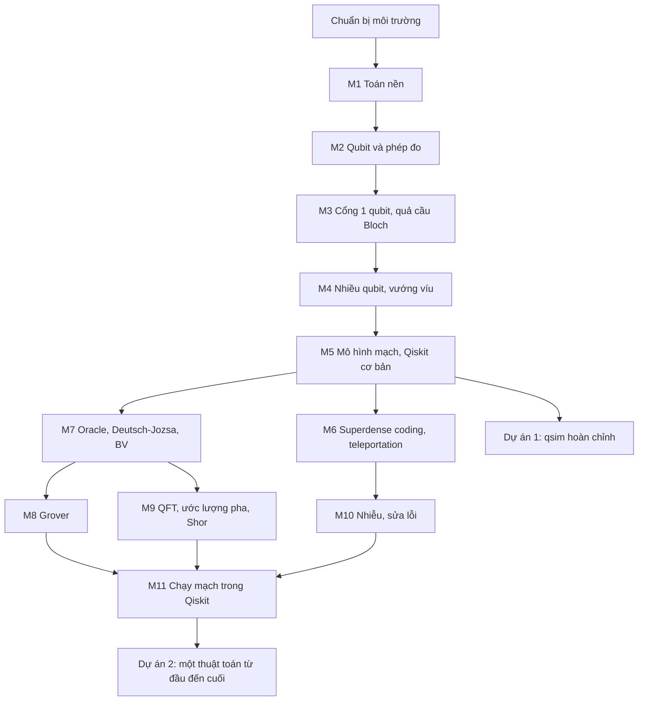

# Lộ trình Quantum Computing Zero to Hero (phiên bản 2, cập nhật 2026-10-10)

> Học xong lộ trình này, bạn tính tay được trạng thái và xác suất đo của mạch 1-3 qubit, có simulator state-vector tự viết (`qsim`) khớp Qiskit, cài đặt và giải thích được superdense coding, teleportation, Deutsch-Jozsa, Bernstein-Vazirani, Grover, QFT, ước lượng pha, phác thảo được Shor, và mô phỏng được nhiễu cùng mã sửa lỗi bit-flip. File: `Quantum_Computing/Roadmaps/ROADMAP.md`, thay cho [lo-trinh-quantum-zero-to-hero.md](../lo-trinh-quantum-zero-to-hero.md). Nguồn sự thật (source of truth): việc và hạn ở [TASKS.md](../TASKS.md); tiến độ kata ở [katas/.state.json](../katas/.state.json) (xem bằng `python katas/qk.py status`); tiến độ simulator là kết quả `pytest` của [qsim/test_qsim.py](../qsim/test_qsim.py); thứ tự học và nội dung ở file này.

## Mục lục

1. [Cách dùng lộ trình này](#1-cách-dùng-lộ-trình-này)
2. [Bức tranh toàn cảnh](#2-bức-tranh-toàn-cảnh)
3. [Trạng thái hiện tại và lịch](#3-trạng-thái-hiện-tại-và-lịch)
4. [Các module](#4-các-module) (M1-M11)
5. [Ôn tập giãn cách và ôn xen kẽ](#5-ôn-tập-giãn-cách-và-ôn-xen-kẽ)
6. [Dự án tổng hợp](#6-dự-án-tổng-hợp)
7. [Sổ lỗi và cách hỏi DeepTutor](#7-sổ-lỗi-và-cách-hỏi-deeptutor)
8. [Tài liệu cũ trong thư mục này](#8-tài-liệu-cũ-trong-thư-mục-này)
9. [Theo dõi tiến độ](#9-theo-dõi-tiến-độ)
10. [Nguồn tham khảo](#10-nguồn-tham-khảo)

## 1. Cách dùng lộ trình này

**Vòng lặp mỗi module:** (1) đọc "Vì sao học" và "Đầu ra" (thứ được kiểm ở Checkpoint); (2) đọc "Kiến thức cốt lõi" theo thứ tự trực giác, ví dụ, công thức, và tự làm lại ví dụ trên giấy; (3) mở đúng phần tài liệu được chỉ định; (4) thực hành ba tầng Khởi động, Cốt lõi, Thử thách (tùy chọn), luôn ghi dự đoán trước khi chạy mạch hoặc chấm kata (predict-then-run), lệch thì ghi Sổ lỗi (§7); (5) Tự kiểm tra: viết câu trả lời rồi mới mở "Đáp án"; (6) đạt Checkpoint thì ghi ngày xong D vào lịch ôn (§5) và đánh dấu ở §9.

**Nhịp tuần:** tuần 1-2 có hai buổi 60 phút (thứ Ba, thứ Bảy); tuần 3-10 (2026-10-26 tới 2026-12-20, lúc GCI bận nhất) có buổi ngắn 30 phút thứ Ba và buổi 60 phút thứ Bảy; từ tuần 11 có ba buổi 60 phút (thứ Ba, thứ Năm, thứ Bảy).

| Buổi 60 phút | Việc |
|---|---|
| 0-5 | Ôn giãn cách: 2-3 câu đến hạn (§5), trả lời không nhìn |
| 5-20 | Mô hình tư duy và một phép tính tay |
| 20-50 | Thực hành: dự đoán, chạy, so sánh |
| 50-60 | 1-2 câu tự kiểm tra, cập nhật §9, ghi việc đầu tiên của buổi sau |

Buổi 30 phút: 5 phút ôn, 20 phút cho đúng một việc nhỏ (1-2 kata hoặc một TODO của qsim), 5 phút ghi chép. Tuần có hạn nộp GCI (P0) thì chỉ giữ phần ôn. Khi hỏi DeepTutor "Hôm nay học gì?", lấy mục tiêu từ dòng tuần hiện tại ở §3.

**Chuẩn bị môi trường (tuần 1, khoảng 1 giờ).** Kiểm tra ngày 2026-10-10: Python 3.11.9 trên máy có numpy 2.2.6, pytest 9.1.0 nhưng chưa có `qiskit`, `qiskit-aer`. Kata 001-004 và 26 test Mốc 1-4 của qsim không cần Qiskit; từ kata 005 và ở Mốc 5 thì cần. Đặt virtualenv (môi trường Python riêng) trên ổ C:, không đặt trên SSD: SSD là exFAT với cluster 512 KB nên hàng chục nghìn file nhỏ của virtualenv sẽ chiếm rất nhiều dung lượng thừa. Cài đúng các bản trong [requirements.txt](../requirements.txt) (qiskit 2.5.1, qiskit-aer 0.17.2), là bộ mà [README.md](../README.md) ghi đã kiểm chứng với kata. Theo PyPI (kiểm tra 2026-10-10), bản qiskit ổn định mới nhất là 2.5.2 (2026-08-13), 2.6.0rc1 chỉ là bản thử; qiskit-aer 0.17.2 có wheel Windows cho CPython 3.10-3.13.

```powershell
cd D:\02_Learning_Knowledge\Quantum_Computing
py -3.11 -m venv "$env:USERPROFILE\venvs\quantum"
$py = "$env:USERPROFILE\venvs\quantum\Scripts\python.exe"
& $py -m pip install -r requirements.txt
& $py -c "import qiskit, qiskit_aer; print(qiskit.__version__, qiskit_aer.__version__)"
& $py katas\qk.py status
```

Gọi thẳng `python.exe` của venv thì không cần `Activate.ps1` và không phải đổi Execution Policy; mỗi cửa sổ PowerShell mới chỉ cần gán lại `$py`. Nếu pip không tìm thấy một bản được ghim, cài phần lõi trước (`qiskit==2.5.1 qiskit-aer==0.17.2 numpy scipy matplotlib pylatexenc pytest`). DoD: lệnh thứ năm in `2.5.1 0.17.2`, lệnh cuối in bảng 0/350, `& $py phase0\h_test.py` cho khoảng 50/50.

**Lệnh hằng ngày** (trong `Quantum_Computing`, `python` là python của venv): `python katas/qk.py status` (tiến độ theo bậc); `python katas/qk.py list --bac 3`; `python katas/qk.py run 12` (chấm bài 012); `python katas/qk.py watch` (tự chấm mỗi khi lưu file); `cd qsim; python -m pytest test_qsim.py -k moc1 -q` (chạy một nhóm test).

**Quy tắc kata.** File bài ở `katas/exercises/<bậc>/<chủ đề>/NNN-<tên hàm>.py`, viết vào chỗ `# Your code here`. Luôn chấm theo số bài: lộ trình chỉ chọn một tập con, còn `qk.py next` gợi ý bài chưa xong đầu tiên theo thứ tự toàn cục. Vật lộn ít nhất 10 phút rồi mới xin gợi ý ([katas/README.md](../katas/README.md)). `qk.py hint` mức 1-2 là gợi ý; mức 3 in thân lời giải nên tính như đã xem lời giải (lệnh `solution` còn ghi `saw_solution` vào `.state.json`); khi đó ghi Sổ lỗi và làm lại bài ở mốc D+3.

## 2. Bức tranh toàn cảnh

**Năng lực đầu ra (cuối khóa)**

- Tính tay trạng thái và xác suất đo của mạch 1-3 qubit, kiểm lại bằng `Statevector`.
- qsim của bạn qua đủ 39 test, trong đó 13 test so với Qiskit trên mạch ngẫu nhiên.
- Cài trong Qiskit và giải thích được superdense coding, teleportation, Deutsch-Jozsa, Bernstein-Vazirani, Grover, QFT, ước lượng pha; làm tay phần cổ điển của Shor cho N = 15.
- Mô phỏng nhiễu bằng Aer và giải thích mã lặp 3 qubit.
- 88 kata lõi pass (liệt kê trong từng module); 262 kata còn lại là kho mở rộng.



**Kiến thức nền cần có:** Python (hàm, list, NumPy cơ bản), lượng giác (sin, cos, radian), số nhị phân và XOR; không cần vật lý. Tự kiểm tra nhanh: (1) $\cos(\pi/4)$ bằng bao nhiêu? (2) Số 6 viết bằng 3 bit là gì, bit thứ 1 (đếm từ phải, bắt đầu từ 0) bằng mấy? (3) $1\oplus1\oplus0$? (4) `np.array([[0,1],[1,0]]) @ np.array([1,0])` cho gì? (5) $\log_2 1024$?

<details><summary>Đáp án</summary>

(1) $\sqrt2/2\approx0.7071$. (2) `110`, bit 1 bằng 1. (3) 0. (4) `[0, 1]`. (5) 10. Sai từ hai câu trở lên thì dành 30 phút ôn lượng giác hoặc NumPy trước Module 1.

</details>

**Ngân sách thời gian:** 25 tuần, từ 2026-10-12 tới 2027-04-04, khoảng 57 giờ: 47 giờ cho 11 module, 1 giờ chuẩn bị, 5 buổi ôn xen kẽ, 3 giờ dự án, 1 giờ tổng kết, cộng một tuần đệm. Mười tuần đầu chỉ 1.5-2 giờ/tuần (tổng 16 giờ) vì GCI là P0 và bận nhất từ 2026-10-29 (bắt đầu phần thi đấu) tới 2026-12-17 (buổi cuối của GCI theo trang chính thức weblab.t.u-tokyo.ac.jp/en/lecture/gci/; hạn Competition và Final Assignment chưa công bố); từ 2026-12-21 khoảng 3 giờ/tuần. Số giờ, tuần và kata lõi của từng module ghi ở đầu module; lịch chi tiết ở §3.

**Liên kết với các khóa khác:**
- GCI (Buổi 2 NumPy) và Machine Learning: dùng lại NumPy (`np.allclose`, dtype complex, vector hóa) và đại số tuyến tính; xem 3Blue1Brown một lần, ghi chú dùng chung, vì trị riêng (eigenvalue) cũng là nền của PCA trong ML.
- Phần thống kê của GCI và ML: độ lệch chuẩn và phân phối nhị thức dùng để đọc counts; không học lại xác suất riêng cho quantum.
- Python Master: đọc traceback, viết hàm sạch, pytest; qsim là bài luyện pytest thật. AMD AI Agents 101: không có chồng lấn đáng kể, không ghép buổi.

## 3. Trạng thái hiện tại và lịch

**Bạn đang ở đây (kiểm tra 2026-10-10)**

| Hạng mục | Trạng thái | Nguồn |
|---|---|---|
| Lộ trình cũ, cấu trúc dự án; `h_test.py`, `giao_thoa.py`, `bell_test.py` | Xong (đã tick; hạn 2026-09-21, 2026-09-22) | [TASKS.md](../TASKS.md) mục 1 |
| `thuc_hanh_tuong_tac.py` | Chưa xong, quá hạn từ 2026-09-27 | TASKS.md mục 1 |
| Katas | 0/350 pass; 1 lần chấm thử bài 001, chưa pass | `.state.json`, `qk.py status` |
| qsim | Chưa bắt đầu: ma trận còn `None`, các hàm còn `NotImplementedError`; có 39 test | `qsim/qsim.py`, `pytest --collect-only` |
| Môi trường | Python 3.11.9, numpy 2.2.6, pytest 9.1.0; chưa có qiskit, qiskit-aer | kiểm tra trên máy |
| Hạn cũ | Mọi việc chưa xong trong TASKS.md (hạn 2026-09-27 tới 2026-10-09) và mục Quantum trong [ACTIVE_LEARNING.md](../../ACTIVE_LEARNING.md) (hạn 2026-09-28) đã quá hạn; đều là hạn tự đặt | TASKS.md, ACTIVE_LEARNING.md |
| Git | 2 commit (2026-09-06, 2026-09-08); `TASKS.md` chưa được commit | `git log`, `git status` |

TASKS.md ghi "Mốc 5" là dựng Bell, GHZ, QFT, còn [qsim/README.md](../qsim/README.md) và file test định nghĩa Mốc 5 là kiểm chứng chéo với Qiskit; lộ trình này theo README và file test.

**Lịch theo tuần.** Khóa tự học, không có hạn bên ngoài: mọi hạn dưới đây là hạn tự đặt (P2), chốt 21:00 Chủ nhật. Hạn thật ảnh hưởng tới lịch là hạn nộp của GCI (P0), xem ACTIVE_LEARNING.md. "(30')" là buổi ngắn 30 phút.

| Tuần | Ngày học | Giờ | Module | Sản phẩm / DoD | Hạn (tự đặt) |
|---|---|---|---|---|---|
| 1 | 2026-10-13, 10-17 | 2 | Chuẩn bị, M1 | venv chạy; 3Blue1Brown chương 1-4 | 2026-10-18 21:00 |
| 2 | 10-20, 10-24 | 2 | M1 | kata 001-004; tensor tay khớp `np.kron` | 2026-10-25 21:00 |
| 3 | 10-27 (30'), 10-31 | 1.5 | M1, M2 | qsim `-k khoi_tao` pass; Checkpoint M1 | 2026-11-01 21:00 |
| 4 | 11-03 (30'), 11-07 | 1.5 | M2 | `thuc_hanh_tuong_tac.py` chương 1, 3, 5; kata 005, 006 | 2026-11-08 21:00 |
| 5 | 11-10 (30'), 11-14 | 1.5 | M2, M3 | kata 062, 063; `sample()` thử tay; Checkpoint M2 | 2026-11-15 21:00 |
| 6 | 11-17 (30'), 11-21 | 1.5 | M3 | Quantum Country Part II; kata 007-009 | 2026-11-22 21:00 |
| 7 | 11-24 (30'), 11-28 | 1.5 | M3 | kata 010, 012, 014, 016-020 | 2026-11-29 21:00 |
| 8 | 12-01 (30'), 12-05 | 1.5 | M3 | kata 022, 064; qsim 15 passed; Checkpoint M3 | 2026-12-06 21:00 |
| 9 | 12-08 (30'), 12-12 | 1.5 | M4, ôn xen kẽ 1 | đọc Watrous Multiple systems; đề ôn M1-M3 | 2026-12-13 21:00 |
| 10 | 12-15 (30'), 12-19 | 1.5 | M4 | kata 026-029 | 2026-12-20 21:00 |
| 11 | 12-22, 12-24, 12-26 | 3 | M4 | kata 023-025, 030, 031, 033, 039, 043, 046-048; qsim TODO 3.x | 2026-12-27 21:00 |
| 12 | 12-29, 12-31, 2027-01-02 | 3 | M4, M5 | kata 066, 067, 073; qsim 26 passed; Checkpoint M4; 2 đẳng thức mạch | 2027-01-03 21:00 |
| 13 | 01-05, 01-07, 01-09 | 3 | M5, ôn xen kẽ 2, M6 | qsim 39 passed; kata 240, 252, 255-257; đề ôn M1-M5 | 2027-01-10 21:00 |
| 14 | 01-12, 01-14, 01-16 | 3 | M6 | kata 115-118, 101-104; bảng sửa lỗi của Bob | 2027-01-17 21:00 |
| 15 | 01-19, 01-21, 01-23 | 3 | M7 | kata 096, 130-133, 149-151 | 2027-01-24 21:00 |
| 16 | 01-26, 01-28, 01-30 | 3 | M7, ôn xen kẽ 3 | kata 153, 157, 158, 160; bảng DJ; đề ôn M4-M7 | 2027-01-31 21:00 |
| 17 | 02-02, 02-04, 02-06 | 3 | M8 | kata 095, 171, 172, 175-178 | 2027-02-07 21:00 |
| 18 | 02-09, 02-11, 02-13 | 0-3 | Tuần đệm | bù phần trễ hoặc Thử thách M6-M8 | 2027-02-14 21:00 |
| 19 | 02-16, 02-18, 02-20 | 3 | M8, M9 | đồ thị P(k); Checkpoint M8; kata 189-192 | 2027-02-21 21:00 |
| 20 | 02-23, 02-25, 02-27 | 3 | M9 | kata 194-196, 205, 209, 210 | 2027-02-28 21:00 |
| 21 | 03-02, 03-04, 03-06 | 3 | M9, ôn xen kẽ 4, M10 | thí nghiệm QPE; Shor N = 15; đề ôn M6-M9; bảng $P_L$ | 2027-03-07 21:00 |
| 22 | 03-09, 03-11, 03-13 | 3 | M10 | thí nghiệm nhiễu Aer; kata 092, 339, 341-344, 348 | 2027-03-14 21:00 |
| 23 | 03-16, 03-18, 03-20 | 3 | M11 | bảng transpile; thí nghiệm EstimatorV2 | 2027-03-21 21:00 |
| 24 | 03-23, 03-25, 03-27 | 3 | Dự án 2 | notebook đạt DoD | 2027-03-28 21:00 |
| 25 | 03-30, 04-03 | 2 | Ôn xen kẽ 5, tổng kết | đề ôn M1-M11; cập nhật §9 và TASKS.md | 2027-04-04 21:00 |

Tuần 18 là tuần đệm, giả định trùng kỳ nghỉ Tết 2027 (mùng 1 Tết là thứ Bảy 2027-02-06 theo thuvienphapluat.vn, nên tuần 17 cũng có thể trúng kỳ nghỉ); nếu không trùng, dời tuần đệm sang đúng tuần bạn nghỉ. Dự án 1 làm dần ở tầng Thử thách của M8-M9.

## 4. Các module

### Module 1 - Toán nền: số phức, vector, ma trận, tích tensor, xác suất  (ước lượng: 4 giờ, tuần 1-3)

**Vì sao học:** Mọi phép tính trong khóa là nhân ma trận phức nhỏ với một vector rồi lấy bình phương độ lớn; thiếu nền này thì kata thành đoán mò.

**Đầu ra (làm được sau module):**
- Chuyển $a+bi\leftrightarrow re^{i\varphi}$; tính $|z|$, $\arg z$, $\bar z$ không cần máy.
- Tính tích trong có liên hợp, chuẩn hóa vector phức, kiểm tra $U^\dagger U = I$.
- Tính tay tích tensor của vector và ma trận 2×2, khớp `np.kron`; ước lượng sai số của số đếm khi lặp N lần.

**Kiến thức cốt lõi**
- Mô hình tư duy: trạng thái là mũi tên độ dài 1 trong không gian vector phức; cổng là phép quay giữ độ dài (unitary); phép đo biến mũi tên thành xác suất.
- Số phức: $z = a+bi = re^{i\varphi}$, $r = \sqrt{a^2+b^2}$, $\varphi = \operatorname{atan2}(b,a)$, $|z|^2 = z\bar z$, $e^{i\varphi} = \cos\varphi+i\sin\varphi$. Nhân với $e^{i\varphi}$ là quay mà không đổi độ dài: pha không hiện trong xác suất nhưng quyết định giao thoa. Python: `abs(z)`, `cmath.phase(z)`, `z.conjugate()`, số ảo viết `1j`.
- Tích trong $\langle u|v\rangle = \sum_k\bar u_kv_k$, chuẩn $\|v\| = \sqrt{\langle v|v\rangle}$. Với $u = (1,i)/\sqrt2$, $v = (1,-i)/\sqrt2$: $\langle u|v\rangle = (1+(-i)(-i))/2 = 0$, trực giao; quên liên hợp thì ra 1. `np.vdot(u, v)` có liên hợp, `u @ v` thì không.
- Ma trận: mạch "A rồi B" là ma trận $BA$. $A^\dagger = \bar A^T$; unitary ($U^\dagger U = I$) nghĩa là $U^{-1} = U^\dagger$ nên mọi cổng đảo ngược được; Hermitian ($A^\dagger = A$) có trị riêng thực, dùng làm đại lượng đo. $H = \frac1{\sqrt2}\begin{pmatrix}1&1\\1&-1\end{pmatrix}$ là cả hai.
- Tensor product (tích tensor, cách ghép hệ): $(a,b)\otimes(c,d) = (ac,ad,bc,bd)$ và $(A\otimes B)(|u\rangle\otimes|v\rangle) = A|u\rangle\otimes B|v\rangle$; n qubit cần $2^n$ số phức. $(1,0,0,1)/\sqrt2$ không phải một tích: cần $ad = bc = 0$ nhưng $ac\cdot bd = 1/2$. Đây là mầm của vướng víu.
- Xác suất: lặp N lần, số đếm dao động quanh $Np$ với độ lệch chuẩn $\sqrt{Np(1-p)}$; N = 1000, p = 0.5 cho khoảng $500\pm16$.

**Hiểu lầm và lỗi hay gặp:**
- Dùng `u @ v` làm tích trong -> thiếu liên hợp; nhận ra: $\langle v|v\rangle$ không ra số thực dương.
- Viết `j` thay vì `1j` -> Python hiểu là tên biến; nhận ra: `NameError`.
- Viết mạch "A rồi B" thành $AB$ -> sai khi A, B không giao hoán; nhận ra: thử tay trên $|0\rangle$.
- Đảo `np.kron(A, B)` thành `np.kron(B, A)` -> đảo vai trò các qubit; nhận ra: kết quả nhiều qubit lệch chỗ (quy ước ở [ky-hieu-toan.md](../docs/ky-hieu-toan.md) mục 5).

**Tài liệu**
- Trong thư mục: [ky-hieu-toan.md](../docs/ky-hieu-toan.md) mục 1-5 và [thuat-ngu.md](../docs/thuat-ngu.md) bảng "Phase 1" (30 phút).
- Bên ngoài: [3Blue1Brown, Essence of linear algebra](https://www.3blue1brown.com/lessons/vectors), chương 1-4 và 9 (70 phút); [Watrous, Single systems](https://quantum.cloud.ibm.com/learning/en/courses/basics-of-quantum-information/single-systems/introduction), chỉ phần Classical information (40 phút); [de Wolf, Lecture Notes](https://arxiv.org/abs/1907.09415), Appendix A-B để tra cứu khi bí (30 phút).

**Thực hành**
- Khởi động (15-20 phút): dự đoán rồi kiểm bằng Python $|3+4i|$, $\arg(i)$, $(1+i)(1-i)$, $e^{i\pi/2}$, chuẩn hóa $(1, i)$. DoD: 5/5 khớp.
- Cốt lõi (45-60 phút): kata 001-004 (chỉ cần NumPy); tính tay $|0\rangle\otimes|+\rangle$ và $H\otimes I$ rồi so với `np.kron`; điền TODO 1.5 của qsim. DoD: 4 kata pass; `python -m pytest test_qsim.py -k khoi_tao -q` báo 1 passed; hai phép tính tensor khớp.
- Thử thách (tùy chọn): chứng minh $\|Uv\| = \|v\|$ cho mọi unitary U trong một dòng. DoD: DeepTutor xác nhận lập luận.

**Tự kiểm tra**
1. $|1-i|$ và $\arg(1-i)$ bằng bao nhiêu?
2. Vì sao tích trong phải liên hợp vector thứ nhất?
3. Dự đoán `np.kron([1,0],[0,1])`.
4. Đo 1000 lần, p(0) = 0.5, ra 530 lần '0': đáng ngờ không? 600 thì sao?
5. Mạch A rồi B rồi C: ma trận tổng là gì?

<details><summary>Đáp án</summary>

1. $\sqrt2$ và $-\pi/4$.
2. Để $\langle v|v\rangle = \sum|v_k|^2$ là số thực không âm; không liên hợp thì $(1, i)$ có "độ dài bình phương" $1+i^2 = 0$.
3. `[0, 1, 0, 0]`, tức $|01\rangle$.
4. Độ lệch chuẩn khoảng 16: 530 lệch 1.9 lần độ lệch chuẩn, bình thường; 600 lệch 6.3 lần, gần như chắc chắn có vấn đề.
5. $CBA$.

</details>

**Checkpoint:**
- [ ] Kata 001-004 và qsim `-k khoi_tao` pass; hai phép tính tensor tay khớp `np.kron`.
- [ ] Đúng ít nhất 4/5 câu tự kiểm tra mà không mở đáp án.

### Module 2 - Qubit, biên độ và phép đo  (ước lượng: 3 giờ, tuần 3-5)

**Vì sao học:** Biên độ có dấu và pha nên triệt tiêu được nhau (giao thoa), xác suất thì không; mọi tăng tốc lượng tử về sau dựa vào khác biệt này.

**Đầu ra (làm được sau module):**
- Kiểm tra chuẩn hóa của $\alpha|0\rangle+\beta|1\rangle$ và tính xác suất đo bằng quy tắc Born.
- Giải thích bằng phép tính vì sao "H, H" trả về $|0\rangle$ còn "H, đo, H" cho 50/50.
- Nói được trạng thái sau phép đo; phân biệt pha toàn cục với pha tương đối.

**Kiến thức cốt lõi**
- Bit ngẫu nhiên cổ điển là vector xác suất $(p_0, p_1)$; qubit là vector amplitude (biên độ) phức $(\alpha, \beta)$ với $|\alpha|^2+|\beta|^2 = 1$. Born rule (quy tắc Born): đo theo cơ sở chuẩn cho 0 với xác suất $|\alpha|^2$, cho 1 với $|\beta|^2$; tổng quát, đo theo cơ sở trực chuẩn $\{|b_k\rangle\}$ thì $P(k) = |\langle b_k|\psi\rangle|^2$ và sau đo trạng thái là $|b_k\rangle$.
- Interference (giao thoa): $H|0\rangle = (|0\rangle+|1\rangle)/\sqrt2$ cho 50/50; áp H lần nữa được $\tfrac12[(|0\rangle+|1\rangle)+(|0\rangle-|1\rangle)] = |0\rangle$, vì hai đường tới $|1\rangle$ có biên độ $+\tfrac12$ và $-\tfrac12$. Tung đồng xu hai lần vẫn 50/50 vì xác suất không âm, không trừ nhau được.
- Collapse (sập trạng thái): đo là ghi kết quả vào một bản ghi cổ điển (thiết bị, môi trường); hai nhánh đã bị phân biệt nên không giao thoa nữa, và mọi dự đoán sau đó khớp với trạng thái vừa đo. Trong mô hình toán đây là tiên đề, khớp với thí nghiệm: đo lại ngay cho kết quả cũ. Mạch C của [phase0/giao_thoa.py](../phase0/giao_thoa.py) (đo xen giữa hai cổng H) cho thấy giao thoa biến mất.
- Pha: $e^{i\gamma}|\psi\rangle$ cho cùng xác suất trong mọi phép đo (global phase, pha toàn cục). Nhưng $|+\rangle$ và $|-\rangle = (|0\rangle-|1\rangle)/\sqrt2$ khác nhau thật (relative phase, pha tương đối): theo Z đều 50/50, sau một cổng H thì một bên luôn ra 0, bên kia luôn ra 1. Đo theo cơ sở khác nghĩa là quay trước rồi đo ([bang-tra-cong.md](../docs/bang-tra-cong.md) mục 5). Máy thật chỉ cho counts (số đếm qua nhiều shots); `Statevector` chỉ có trong mô phỏng.

**Hiểu lầm và lỗi hay gặp:**
- "Superposition (chồng chập) là vừa 0 vừa 1" -> đo chỉ cho 1 bit; nhận ra: nếu đúng vậy thì "H, H" cũng phải ra 50/50.
- "Chồng chập là ta chưa biết, như đồng xu bị che" -> hỗn hợp 50/50 qua H vẫn 50/50, còn $|+\rangle$ qua H ra 0 chắc chắn; nhận ra: so hai mạch ở tầng Thử thách ([thuat-ngu.md](../docs/thuat-ngu.md), mục "Ba cặp từ hay bị dùng lẫn").
- Coi counts là xác suất chính xác -> có sai số thống kê; nhận ra: 1000 shots dao động khoảng ±16 quanh 500.
- Coi pha toàn cục -1 là lỗi -> không quan sát được, trừ khi cổng được điều khiển; nhận ra: ghi chú trong đề kata 022.

**Tài liệu**
- Trong thư mục: [phase0/thuc_hanh_tuong_tac.py](../phase0/thuc_hanh_tuong_tac.py) chương 1, 3, 5 (không cần Qiskit); [h_test.py](../phase0/h_test.py), [giao_thoa.py](../phase0/giao_thoa.py) (tổng 40 phút).
- Bên ngoài: [Quantum Country, Quantum computing for the very curious](https://quantum.country/qcvc), Part I "The state of a qubit" (45 phút; có câu hỏi ôn chèn trong bài, đăng nhập để được nhắc ôn theo lịch); [Watrous, Single systems](https://quantum.cloud.ibm.com/learning/en/courses/basics-of-quantum-information/single-systems/introduction), phần Quantum information và Qiskit implementations (60 phút); [3Blue1Brown chương 13, Change of basis](https://www.3blue1brown.com/lessons/change-of-basis) (15 phút).

**Thực hành**
- Khởi động (15-20 phút): `thuc_hanh_tuong_tac.py` chương 1 và 3; ghi số đếm dự đoán kèm sai số trước mỗi lần bắn shots. DoD: 3 dự đoán nằm trong ±3 độ lệch chuẩn.
- Cốt lõi (45-60 phút): kata 005, 006, 062, 063 (với 063: đo xong bạn biết qubit ở đâu; nếu ra 1 thì cần làm gì?); rồi TODO 4.1 `probabilities()` và 4.2 `sample()`, thử tay vì test Mốc 4 cần cổng: `s = QSim(1); s.state = np.array([0.5, 0.75**0.5], dtype=complex); s.sample(20000, seed=7)`. DoD: 4 kata pass; tần suất '1' trong 0.75 ± 0.01; ký tự phải nhất của chuỗi là qubit 0.
- Thử thách (tùy chọn): chạy "H, H" và "H, đo, H" 1000 shots, giải thích chênh lệch bằng biên độ trong 5 câu.

**Tự kiểm tra**
1. $\tfrac{\sqrt3}2|0\rangle-\tfrac i2|1\rangle$: P(0), P(1)?
2. Dự đoán 1000 shots cho "H, H, đo" và cho lần đo cuối của "H, đo, H, đo".
3. $|1\rangle$ và $-|1\rangle$ có phân biệt được bằng thí nghiệm nào không? $|+\rangle$ và $|-\rangle$ thì sao?
4. $(|0\rangle+i|1\rangle)/\sqrt2$, áp H rồi đo: P(0)?
5. p = 0.5, 100 shots: độ lệch chuẩn của số đếm?

<details><summary>Đáp án</summary>

1. 3/4 và 1/4 ($|-i/2|^2 = 1/4$).
2. 1000 lần '0'; khoảng 500/500.
3. Không, chỉ khác pha toàn cục. Có: áp H rồi đo.
4. $H|\psi\rangle = \tfrac12[(1+i)|0\rangle+(1-i)|1\rangle]$ nên $P(0) = |1+i|^2/4 = 1/2$.
5. $\sqrt{100\cdot0.5\cdot0.5} = 5$, tức khoảng $50\pm5$.

</details>

**Checkpoint:**
- [ ] Kata 005, 006, 062, 063 pass; `sample()` qua phép thử 25/75; xong `thuc_hanh_tuong_tac.py` chương 1, 3, 5.
- [ ] Giải thích "H, H" và "H, đo, H" mà không nhìn ghi chú.

### Module 3 - Cổng 1 qubit và quả cầu Bloch  (ước lượng: 5 giờ, tuần 5-8)

**Vì sao học:** Mọi thuật toán là chuỗi cổng 1 qubit xen với CNOT; biết mỗi cổng làm gì với biên độ và pha là nắm một nửa việc đọc mạch.

**Đầu ra (làm được sau module):**
- Viết ma trận X, Y, Z, H, S, T, $R_x, R_y, R_z$ và áp tay lên $|0\rangle, |1\rangle, |\pm\rangle$; đổi trạng thái sang tọa độ Bloch.
- Chứng minh $HZH = X$; kiểm tra $S^2 = Z$, $T^2 = S$, $R_x(\pi) = -iX$.
- Cài qsim Mốc 1-2 (ma trận cổng, `apply_1q` bằng ghép cặp biên độ) với 15 test xanh.

**Kiến thức cốt lõi**
- Bloch sphere (quả cầu Bloch): bỏ pha toàn cục, mọi trạng thái là $\cos\frac\theta2|0\rangle+e^{i\varphi}\sin\frac\theta2|1\rangle$, tức điểm $(\sin\theta\cos\varphi, \sin\theta\sin\varphi, \cos\theta)$; cổng 1 qubit là một phép quay quả cầu. Góc chia đôi vì $|0\rangle$, $|1\rangle$ trực giao nhưng nằm ở hai cực đối nhau; $|\pm\rangle$ ở $\pm x$, $(|0\rangle\pm i|1\rangle)/\sqrt2$ ở $\pm y$.
- Cổng (ma trận ở [bang-tra-cong.md](../docs/bang-tra-cong.md) mục 1): X lật bit ($\pi$ quanh x), Z lật pha ($\pi$ quanh z), $Y = iXZ$; $H = (X+Z)/\sqrt2$ đổi chỗ trục x và z; $S = \operatorname{diag}(1,i)$ và $T = \operatorname{diag}(1,e^{i\pi/4})$ quay $\pi/2$ và $\pi/4$ quanh z; $R_a(\theta) = e^{-i\theta\sigma_a/2}$, ví dụ $R_y(\theta)|0\rangle = \cos\frac\theta2|0\rangle+\sin\frac\theta2|1\rangle$.
- Đẳng thức: $HXH = Z$, $HZH = X$, $HYH = -Y$, $S^2 = Z$, $T^2 = S$, $R_x(\pi) = -iX$ ("lật bit trong cơ sở X là lật pha trong cơ sở Z", mẹo dùng lại ở mọi thuật toán). $R_z(\lambda) = e^{-i\lambda/2}P(\lambda)$: chỉ khác pha toàn cục, nhưng khi được điều khiển thì thành pha tương đối; qsim phải dùng dạng $\operatorname{diag}(e^{-i\lambda/2}, e^{i\lambda/2})$ như Qiskit.
- Pairwise indexing (ghép cặp biên độ), Mốc 2: áp U lên qubit t chỉ trộn các cặp chỉ số khác nhau đúng ở bit t, mỗi cặp được nhân với U như vector 2 chiều; n = 2, t = 0 cho các cặp (0,1), (2,3), còn t = 1 cho (0,2), (1,3). Có $2^{n-1}$ cặp nên mỗi cổng tốn $O(2^n)$ thay vì $O(4^n)$. Docstring của `apply_1q` trong [qsim/qsim.py](../qsim/qsim.py) mô tả ý này; phần của bạn là viết code đúng.

**Hiểu lầm và lỗi hay gặp:**
- Viết $R_z(\theta) = \operatorname{diag}(1,e^{i\theta})$ -> lệch pha toàn cục so với Qiskit; nhận ra: `test_moc1_cong_quay` báo `rz(pi)` sai.
- Quên góc chia đôi, dùng $R_y(\pi/4)$ để tạo $|+\rangle$ -> cần $R_y(\pi/2)$; nhận ra: kết quả khoảng 85/15 thay vì 50/50.
- "Z không làm gì vì xác suất không đổi" -> Z đổi pha tương đối; nhận ra: thêm H sau Z thì kết quả đổi hẳn.
- `apply_1q` ghi đè `state[i]` rồi mới tính `state[j]`, hoặc dựng ma trận $2^n\times2^n$ -> sai số liệu hoặc tốn $O(4^n)$; nhận ra: test giữ chuẩn hóa fail, hoặc test 15 qubit treo ([faq-loi-hay-gap.md](../docs/faq-loi-hay-gap.md) mục C).

**Tài liệu**
- Trong thư mục: [bang-tra-cong.md](../docs/bang-tra-cong.md) mục 1, 3-5; `thuc_hanh_tuong_tac.py` chương 2; [qsim/README.md](../qsim/README.md) (tổng 40 phút).
- Bên ngoài: [Quantum Country qcvc](https://quantum.country/qcvc), Part II "Introducing quantum logic gates" (60 phút); [de Wolf](https://arxiv.org/abs/1907.09415), mục 1.3-1.4 (25 phút); [IBM Quantum Learning, Bloch sphere](https://quantum.cloud.ibm.com/learning/en/courses/general-formulation-of-quantum-information/density-matrices/bloch-sphere), phần trạng thái thuần, bỏ qua ma trận mật độ (20 phút).

**Thực hành**
- Khởi động (15-20 phút): tính tay $X|+\rangle$, $Z|+\rangle$, $H|-\rangle$, $S|+\rangle$, $HZH$, $T^2$; kiểm bằng NumPy. DoD: 6/6 khớp.
- Cốt lõi (rải trong 3 tuần): kata 007-010, 012, 014, 016-020, 022, 064; rồi qsim TODO 1.1-1.4 và 2.1. Câu hỏi dẫn cho 012 và 019: viết $R_x(\theta)|0\rangle$ và $R_y(\theta)|0\rangle$ ra biên độ rồi so với đề: góc phải bằng bao nhiêu theo $\alpha$? DoD: 13 kata pass; `-k "moc1 or moc2"` báo 15 passed.
- Thử thách (tùy chọn): kata 011, 013, 015, 021, 065; tìm trục quay Bloch của H từ $HXH = Z$ và $HYH = -Y$.

**Tự kiểm tra**
1. Dự đoán xác suất đo của $HSH|0\rangle$.
2. $R_x(\pi/2)|0\rangle$ nằm đâu trên quả cầu, và vì sao không phải $|+\rangle$?
3. Khi nào khác biệt giữa $R_z(\lambda)$ và $P(\lambda)$ có hậu quả?
4. qsim với n = 3, cổng trên qubit t = 1: liệt kê các cặp chỉ số.
5. Chứng minh $HZH = X$.

<details><summary>Đáp án</summary>

1. $HSH|0\rangle = \tfrac12[(1+i)|0\rangle+(1-i)|1\rangle]$: 50/50 dù có ba cổng.
2. $(|0\rangle-i|1\rangle)/\sqrt2$, điểm (0, -1, 0): quay quanh trục x đưa cực bắc về -y, không về +x.
3. Khi cổng được điều khiển: pha $e^{-i\lambda/2}$ chỉ áp lên nhánh control = 1 nên thành pha tương đối.
4. (0,2), (1,3), (4,6), (5,7).
5. $HZ = \tfrac1{\sqrt2}\begin{pmatrix}1&-1\\1&1\end{pmatrix}$; nhân tiếp với H được $\tfrac12\begin{pmatrix}0&2\\2&0\end{pmatrix} = X$.

</details>

**Checkpoint:**
- [ ] 13 kata lõi pass; qsim Mốc 1-2: 15 passed.
- [ ] Giải thích miệng trong 2 phút vì sao ghép cặp là $O(2^n)$.

### Module 4 - Hệ nhiều qubit và vướng víu  (ước lượng: 6 giờ, tuần 9-12)

**Vì sao học:** Năng lực tính toán (và sự kỳ lạ) chỉ xuất hiện từ 2 qubit trở lên: không gian $2^n$ chiều và những trạng thái không tách được thành từng qubit.

**Đầu ra (làm được sau module):**
- Đọc chuỗi kết quả theo quy ước Qiskit (qubit 0 là ký tự phải nhất); mô tả CNOT, CZ, SWAP; dựng 4 trạng thái Bell và GHZ.
- Kiểm tra trạng thái 2 qubit có tách được không; tính trạng thái sau khi đo một qubit.
- Chứng minh bằng tính toán rằng vướng víu không truyền được tin; qsim Mốc 1-4 xanh (26 test).

**Kiến thức cốt lõi**
- Product state (trạng thái tích): mỗi qubit có trạng thái riêng. Entanglement (vướng víu): chỉ có trạng thái chung, tương quan nằm trong biên độ chung chứ không trong từng qubit.
- Quy ước: Qiskit viết $|q_{n-1}\dots q_0\rangle$, chỉ số $=\sum_kq_k2^k$; `qc.x(0)` trên 2 qubit cho '01'. Nhiều đề kata (gốc Q#) dùng thứ tự mảng: đề 067 ghi $|10\rangle$ nghĩa là `qs[0]` = 1, `qs[1]` = 0, ngược với cách Qiskit in chuỗi. Ghi quy ước vào comment trước khi code mọi kata nhiều qubit.
- CNOT: $|c,t\rangle\mapsto|c, t\oplus c\rangle$; CZ đổi dấu khi cả hai qubit bằng 1 (đối xứng); SWAP bằng 3 CNOT ([bang-tra-cong.md](../docs/bang-tra-cong.md) mục 2). Bell: $|00\rangle\xrightarrow{H_0}(|00\rangle+|01\rangle)/\sqrt2\xrightarrow{CX_{0\to1}}(|00\rangle+|11\rangle)/\sqrt2 = |\Phi^+\rangle$.
- Phép thử tách được: $(a|0\rangle+b|1\rangle)\otimes(c|0\rangle+d|1\rangle)$ có $\alpha_{00}\alpha_{11} = abcd = \alpha_{01}\alpha_{10}$; ngược lại, hai tích bằng nhau thì ma trận biên độ 2×2 có hạng 1 nên tách được. Với $|\Phi^+\rangle$: $1/2\ne0$, vướng víu; $|+\rangle|+\rangle$ chồng chập nhưng không vướng víu.
- Đo một phần: đo $q_0$ cho 1 với xác suất $|\alpha_{01}|^2+|\alpha_{11}|^2$; giữ các số hạng có $q_0 = 1$ rồi chuẩn hóa lại. No-signalling (không truyền tin): Alice và Bob giữ $|\Phi^+\rangle$; Alice đo hay không đo, xác suất Bob ra 0 vẫn là 1/2; tương quan chỉ lộ khi hai người so bản ghi qua kênh cổ điển.

**Hiểu lầm và lỗi hay gặp:**
- Đọc '01' là $q_0 = 0$, hoặc code theo chuỗi Qiskit khi đề dùng thứ tự `qs[0]` trước -> sai với trạng thái bất đối xứng; nhận ra: luôn thử thêm một trạng thái như $|0\rangle\otimes|-\rangle$ ([Qiskit bit ordering](https://quantum.cloud.ibm.com/docs/en/guides/bit-ordering)).
- "Đo qubit này làm qubit kia đổi ngay nên gửi tin được" -> thống kê phía Bob không đổi; nhận ra: tính xác suất Bob ra 0 ở cả hai trường hợp.
- "CNOT sao chép bit nên sao chép được qubit" -> CNOT trên $|+\rangle|0\rangle$ cho $|\Phi^+\rangle$, không phải $|+\rangle|+\rangle$; nhận ra: so hai vector trạng thái.
- qsim `cx` đổi mỗi cặp hai lần (thiếu điều kiện bit t bằng 0) -> trạng thái không đổi; nhận ra: bảng độ lệch trong [qsim/README.md](../qsim/README.md).

**Tài liệu**
- Trong thư mục: [ky-hieu-toan.md](../docs/ky-hieu-toan.md) mục 5-6; [bang-tra-cong.md](../docs/bang-tra-cong.md) mục 2 và bảng Bell; [phase0/bell_test.py](../phase0/bell_test.py) (chỉ in phần thực của biên độ, đủ cho trạng thái Bell) và `thuc_hanh_tuong_tac.py` chương 4 (tổng 35 phút).
- Bên ngoài: [Watrous, Multiple systems](https://quantum.cloud.ibm.com/learning/courses/basics-of-quantum-information/multiple-systems/introduction), phần Quantum information và Qiskit implementations (75 phút); [Qiskit, Bit ordering in the Qiskit SDK](https://quantum.cloud.ibm.com/docs/en/guides/bit-ordering) (15 phút).

**Thực hành**
- Khởi động (20 phút): tính tay CNOT (control $q_0$) trên $|+\rangle_{q_0}|0\rangle_{q_1}$; áp phép thử tách được cho 3 trạng thái tự chọn; kiểm bằng `Statevector`. DoD: 3/3 khớp.
- Cốt lõi (rải trong 4 tuần): kata 023-031, 033, 039, 043, 046-048, 066, 067, 073; rồi qsim TODO 3.1-3.3 và 4.3. DoD: 18 kata pass; `-k moc` báo 26 passed.
- Thử thách (tùy chọn): kata 035-038, 040, 049-061 (W state ở 060-061), 080-087 (joint measurement, đo chung nhiều qubit).

**Tự kiểm tra**
1. `qc = QuantumCircuit(3); qc.x(1); qc.measure_all()`: chuỗi kết quả?
2. $(|00\rangle+|01\rangle-|10\rangle-|11\rangle)/2$ có vướng víu không?
3. Alice, Bob giữ $|\Phi^+\rangle$, Alice đo được 1: Bob đang có gì? Bob có biết Alice đã đo không?
4. Đo $q_0$ của $(|00\rangle+|01\rangle+|11\rangle)/\sqrt3$: xác suất ra 1 và trạng thái sau đó?
5. Dự đoán counts của "H(0), CX(0,1), H(0), H(1), đo".

<details><summary>Đáp án</summary>

1. '010'.
2. Không: $\alpha_{00}\alpha_{11} = -1/4 = \alpha_{01}\alpha_{10}$; đó là $|-\rangle_{q_1}|+\rangle_{q_0}$.
3. $|1\rangle$. Không: thiếu tin nhắn của Alice thì Bob vẫn thấy 50/50.
4. 2/3; trạng thái $|+\rangle_{q_1}|1\rangle_{q_0}$.
5. $|\Phi^+\rangle = (|{+}{+}\rangle+|{-}{-}\rangle)/\sqrt2$ nên sau hai cổng H được $(|00\rangle+|11\rangle)/\sqrt2$: khoảng 50% '00', 50% '11'; tương quan vẫn còn ở cơ sở X.

</details>

**Checkpoint:**
- [ ] 18 kata lõi pass; qsim `-k moc`: 26 passed.
- [ ] Trình bày phép tính no-signalling mà không nhìn.

### Module 5 - Mô hình mạch và Qiskit cơ bản  (ước lượng: 3 giờ, tuần 12-13)

**Vì sao học:** Thuật toán được viết bằng mạch; cần đọc mạch, biến đổi mạch tương đương, và kiểm chứng độc lập: qsim đối chiếu với Qiskit.

**Đầu ra (làm được sau module):**
- Viết ma trận tổng của mạch 2 qubit nhỏ (mạch đọc trái sang phải, ma trận nhân phải sang trái).
- Kiểm chứng $CZ = (I\otimes H)\,CX\,(I\otimes H)$ và việc đảo chiều CNOT bằng 4 cổng H, bằng tay và bằng `Operator.equiv`.
- Tính XOR, AND bằng CNOT và Toffoli; giải thích vì sao phải gỡ (uncompute) qubit phụ; qsim đạt 39/39.

**Kiến thức cốt lõi**
- Circuit model (mô hình mạch): dây là qubit, thời gian chạy trái sang phải, hộp là unitary, đo ở cuối; deferred measurement (đo hoãn) cho phép dời mọi phép đo về cuối bằng cách thay điều khiển cổ điển bằng cổng có điều khiển. {H, T, CNOT} là tập cổng phổ dụng (universal): xấp xỉ được mọi unitary (de Wolf mục 2.2).
- Tính toán khả nghịch: mọi hàm cổ điển f viết được thành $|x\rangle|y\rangle\mapsto|x\rangle|y\oplus f(x)\rangle$ bằng X, CNOT, Toffoli (câu hỏi dẫn: qubit đích bắt đầu ở 0 thì Toffoli tính phép logic nào?). Qubit phụ giữ kết quả trung gian phải được gỡ bằng cách chạy ngược phần mạch đã tính; nếu không, chúng vướng víu với đầu vào và phá giao thoa ở Module 7.
- Qiskit tối thiểu: `Statevector(qc)` chỉ dùng cho mạch không có phép đo; `Operator(qc)` cho ma trận của mạch, `Operator(a).equiv(Operator(b))` so hai mạch bỏ qua pha toàn cục; khuôn Sampler ở [bang-tra-cong.md](../docs/bang-tra-cong.md) mục 6; API đã bị xóa như `execute` ở [faq-loi-hay-gap.md](../docs/faq-loi-hay-gap.md) mục B.
- Kiểm chứng chéo (Mốc 5): cùng một mạch ngẫu nhiên chạy trên qsim và Qiskit; lệch cỡ 1e-16 là đúng, từ 1e-1 trở lên thường là sai endian, chỉ lệch dấu hoặc pha thường do $R_z$ ([qsim/README.md](../qsim/README.md)).

**Hiểu lầm và lỗi hay gặp:**
- Nhân ma trận theo thứ tự đọc mạch -> sai khi các cổng không giao hoán; nhận ra: thử tay trên một trạng thái cơ sở.
- Gọi `Statevector` trên mạch có `measure`, hoặc nghĩ `qc.draw()` cùng thứ tự với chuỗi kết quả -> báo lỗi, hoặc đọc ngược qubit (hình để $q_0$ trên cùng, chuỗi để $q_0$ ở phải nhất); nhận ra: [ky-hieu-toan.md](../docs/ky-hieu-toan.md) mục 6.
- So từng phần tử khi hai vector chỉ khác pha toàn cục -> báo sai oan; nhận ra: so $|\langle\varphi|\psi\rangle|$ hoặc dùng `Operator.equiv`.

**Tài liệu**
- Trong thư mục: [ky-hieu-toan.md](../docs/ky-hieu-toan.md) mục 8 và [faq-loi-hay-gap.md](../docs/faq-loi-hay-gap.md) mục B, C (20 phút).
- Bên ngoài: [Watrous, Quantum circuits](https://quantum.cloud.ibm.com/learning/courses/basics-of-quantum-information/quantum-circuits/introduction) (60 phút); [Qiskit, Construct circuits](https://quantum.cloud.ibm.com/docs/en/guides/construct-circuits) (25 phút); [de Wolf](https://arxiv.org/abs/1907.09415), mục 2.1-2.2 (30 phút).

**Thực hành**
- Khởi động (15 phút): dự đoán rồi kiểm bằng `Operator.equiv`: $CZ = H_t\,CX\,H_t$; CX(0,1) kẹp giữa H trên cả hai qubit bằng CX(1,0). DoD: cả hai True, có phép tính tay cho đẳng thức đầu.
- Cốt lõi (60-90 phút): `python -m pytest test_qsim.py -q` (cần Qiskit) cho tới 39 passed; rồi kata 240, 252, 255, 256, 257. DoD: 39/39 và 5 kata pass.
- Thử thách (tùy chọn): kata 241-251, 253-254 (phân biệt các unitary), 258-261 (bộ cộng nhiều bit).

**Tự kiểm tra**
1. Mạch "H trên $q_0$, CX(0,1), H trên $q_0$": viết ma trận tổng theo đúng thứ tự.
2. Dự đoán chuỗi kết quả của `x(0)`, `swap(0,1)`, `measure_all()` trên 2 qubit.
3. Vì sao oracle phải gỡ qubit phụ?
4. Đã qua Mốc 1-4, Mốc 5 còn bắt được lỗi gì?
5. Vector trạng thái 30 qubit (complex128) tốn bao nhiêu bộ nhớ?

<details><summary>Đáp án</summary>

1. $H_0\,CX_{0\to1}\,H_0$ (cổng áp trước đứng bên phải).
2. '10'.
3. Qubit phụ còn giữ thông tin về x thì các nhánh x phân biệt được, giống như đã bị đo, nên không giao thoa.
4. Lỗi chỉ lộ khi trộn nhiều cổng trên nhiều qubit: sai endian, sai dạng $R_z$, nhầm control và target; và nó so với một bản cài độc lập.
5. $2^{30}\times16$ byte = 16 GiB, khoảng 17 GB.

</details>

**Checkpoint:**
- [ ] qsim 39/39; kata 240, 252, 255-257 pass.
- [ ] Hai đẳng thức mạch kiểm bằng tay và bằng `Operator.equiv`.

### Module 6 - Giao thức: superdense coding và teleportation  (ước lượng: 4 giờ, tuần 13-14)

**Vì sao học:** Hai giao thức đầu tiên dùng vướng víu như một tài nguyên tiêu hao; đồng thời luyện mạch 3 qubit có đo giữa chừng và điều khiển cổ điển.

**Đầu ra (làm được sau module):**
- Nêu đúng tài nguyên: superdense coding (mã hóa siêu đặc) dùng 1 e-bit (cặp Bell chia sẻ trước) và gửi 1 qubit để truyền 2 bit; teleportation (dịch chuyển lượng tử) dùng 1 e-bit và 2 bit cổ điển để chuyển 1 trạng thái qubit.
- Viết trạng thái 3 qubit của teleportation theo cơ sở Bell và suy ra phép sửa của Bob.
- Chứng minh định lý không sao chép; giải thích vì sao teleportation không nhanh hơn ánh sáng.

**Kiến thức cốt lõi**
- No-cloning (không sao chép): nếu $U|\psi\rangle|0\rangle = |\psi\rangle|\psi\rangle$ với mọi $\psi$, lấy tích trong cho $\psi$ và $\varphi$ được $\langle\varphi|\psi\rangle = \langle\varphi|\psi\rangle^2$, tức chỉ có thể là 0 hoặc 1: mâu thuẫn với hai trạng thái khác nhau mà không trực giao.
- Bell measurement (phép đo Bell): mạch tạo Bell là H rồi CX; tự suy ra mạch ngược (dagger từng cổng, đảo thứ tự) rồi đo theo cơ sở chuẩn. Superdense coding: Alice áp I, X, Z, hoặc Z rồi X lên nửa cặp $|\Phi^+\rangle$ của mình (bảng trong đề kata 116) để được một trong 4 trạng thái Bell trực giao; Bob phân biệt chắc chắn bằng phép đo Bell. Không có e-bit thì 1 qubit chỉ mang tối đa 1 bit cổ điển (định lý Holevo, được nhắc trong bài Watrous).
- Teleportation (thứ tự M, A, B; M chứa $\alpha|0\rangle+\beta|1\rangle$; A, B giữ $|\Phi^+\rangle$):

$$|\psi\rangle_M|\Phi^+\rangle_{AB} = \tfrac12\Big[|\Phi^+\rangle(\alpha|0\rangle+\beta|1\rangle)+|\Phi^-\rangle(\alpha|0\rangle-\beta|1\rangle)+|\Psi^+\rangle(\beta|0\rangle+\alpha|1\rangle)+|\Psi^-\rangle(-\beta|0\rangle+\alpha|1\rangle)\Big]$$

  Mỗi kết quả đo Bell trên (M, A) có xác suất 1/4, không phụ thuộc $\alpha, \beta$; qubit của Bob là $|\psi\rangle$ bị tác động bởi I, Z, X hoặc XZ. Việc của bạn: lập bảng 4 dòng "2 bit -> cổng Bob áp" cho đúng mạch đo bạn dùng và đúng thứ tự bit mà kata 102 quy định.
- Trước khi nhận 2 bit, thống kê mọi phép đo của Bob như nhau với mọi $\psi$, nên không có truyền tin nhanh hơn ánh sáng; phép đo của Alice phá trạng thái của M nên cũng không có sao chép. Mở rộng: trong CHSH game, chiến lược cổ điển tốt nhất thắng 75%, chiến lược dùng vướng víu thắng $\cos^2(\pi/8)\approx85.4\%$.

**Hiểu lầm và lỗi hay gặp:**
- "Teleportation chuyển thông tin tức thời" -> cần 2 bit cổ điển; nhận ra: trước khi nhận bit, Bob thấy 50/50 với mọi $\psi$.
- "Superdense coding nén 2 bit vào 1 qubit miễn phí" -> e-bit chia sẻ trước là chi phí thật; nhận ra: đếm tài nguyên ở cả hai phía.
- Đổi chỗ bit của M và bit của A -> áp sai Pauli; nhận ra: kata 102 quy định bit thứ nhất là kết quả đo qubit thông điệp.
- Sửa theo thứ tự Z rồi X thay vì X rồi Z -> chỉ lệch pha toàn cục -1 vì $ZX = -XZ$; nhận ra: nếu test fail, xem test có so cả pha toàn cục không. Điều khiển cổ điển trong Qiskit 2.x viết bằng `with qc.if_test(...)`.

**Tài liệu**
- Trong thư mục: [phase0/bell_test.py](../phase0/bell_test.py); [thuat-ngu.md](../docs/thuat-ngu.md), các dòng teleportation, superdense coding, no-cloning, no-communication (15 phút).
- Bên ngoài: [Watrous, Entanglement in action](https://quantum.cloud.ibm.com/learning/en/courses/basics-of-quantum-information/entanglement-in-action/introduction), phần Teleportation và Superdense coding (70 phút, CHSH tùy chọn); [Quantum Country, How quantum teleportation works](https://quantum.country/teleportation), có mục về truyền tin nhanh hơn ánh sáng và về đo một phần (dưới 60 phút theo tác giả); [de Wolf](https://arxiv.org/abs/1907.09415), mục 1.5 (15 phút).

**Thực hành**
- Khởi động (20 phút): che công thức ở trên, tự suy ra phân tích theo cơ sở Bell, rồi kiểm bằng `Statevector` với $\alpha = \cos0.3$, $\beta = \sin0.3$. DoD: 4 nhánh, mỗi nhánh xác suất 1/4.
- Cốt lõi (2 buổi): kata 115-118; điền bảng 4 dòng rồi làm kata 101-104. DoD: 8 kata pass; bảng được DeepTutor xác nhận.
- Thử thách (tùy chọn): kata 107, 108 (entanglement swapping), 112, 120-129 (BB84), 312-319 (CHSH: mô phỏng 10 000 lượt, tỉ lệ thắng lượng tử nằm trong $0.854\pm0.01$).

**Tự kiểm tra**
1. Kê tài nguyên của hai giao thức.
2. Kết quả đo Bell là $|\Phi^-\rangle$: Bob đang có gì, sửa bằng cổng nào?
3. Vì sao kết quả của Alice không tiết lộ gì về $\alpha, \beta$?
4. Dự đoán: superdense coding gửi "11", 1000 shots trên simulator lý tưởng.
5. Entanglement swapping: A-B và B'-C mỗi cặp giữ $|\Phi^+\rangle$; B đo Bell trên (B, B') rồi gửi 2 bit cho C. A và C ra sao?

<details><summary>Đáp án</summary>

1. Superdense: 1 e-bit và 1 qubit gửi đi để truyền 2 bit. Teleportation: 1 e-bit và 2 bit cổ điển để chuyển 1 trạng thái qubit.
2. $\alpha|0\rangle-\beta|1\rangle = Z|\psi\rangle$; sửa bằng Z.
3. Mỗi kết quả có xác suất 1/4 với mọi $\alpha, \beta$.
4. Cùng một chuỗi 2 bit ở cả 1000 shots (thứ tự ký tự tùy cách nối qubit với bit cổ điển).
5. Sau khi C áp phép sửa Pauli, A và C ở $|\Phi^+\rangle$ dù chưa từng tương tác.

</details>

**Checkpoint:**
- [ ] 8 kata lõi pass.
- [ ] Tự suy ra phân tích theo cơ sở Bell và giải thích "không nhanh hơn ánh sáng" mà không nhìn.

### Module 7 - Oracle, phase kickback, Deutsch-Jozsa, Bernstein-Vazirani  (ước lượng: 5 giờ, tuần 15-16)

**Vì sao học:** Query model (mô hình truy vấn: đếm số lần gọi hộp đen f) cho thấy rõ nhất giao thoa tạo ra lợi thế; phase kickback được dùng lại trong Grover, ước lượng pha và Shor.

**Đầu ra (làm được sau module):**
- Phân biệt marking oracle $|x\rangle|y\rangle\mapsto|x\rangle|y\oplus f(x)\rangle$ và phase oracle $|x\rangle\mapsto(-1)^{f(x)}|x\rangle$; chuyển loại đầu sang loại sau bằng qubit đích ở $|-\rangle$.
- Phân tích DJ, BV bằng $H^{\otimes n}|x\rangle = 2^{-n/2}\sum_z(-1)^{x\cdot z}|z\rangle$ (với $x\cdot z = \sum_ix_iz_i \bmod 2$); cài cả hai với 1 lần gọi oracle.
- Giải thích vì sao "thử mọi đáp án song song" không phải lý do của tăng tốc.

**Kiến thức cốt lõi**
- Phase kickback: $U_f|x\rangle|-\rangle = (-1)^{f(x)}|x\rangle|-\rangle$, vì khi f(x) = 1 thì $|0\oplus1\rangle-|1\oplus1\rangle = -(|0\rangle-|1\rangle)$. Qubit đích không đổi, dấu nằm ở đầu vào.
- Deutsch-Jozsa: $|0\rangle^{\otimes n}$ qua $H^{\otimes n}$, oracle pha, rồi $H^{\otimes n}$; biên độ của $|0\dots0\rangle$ là $2^{-n}\sum_x(-1)^{f(x)}$: bằng $\pm1$ nếu f hằng, bằng 0 nếu f cân bằng. Bernstein-Vazirani: với $f(x) = r\cdot x$, cùng mạch cho đúng $|r\rangle$ vì $\sum_x(-1)^{(r\oplus z)\cdot x}$ bằng $2^n$ khi $z = r$, bằng 0 khi khác.
- So sánh trung thực: DJ chắc chắn đúng cần $2^{n-1}+1$ truy vấn cổ điển ở trường hợp xấu nhất, nhưng thuật toán ngẫu nhiên chỉ cần vài truy vấn để đúng với xác suất cao; BV cần n truy vấn cổ điển so với 1. Tách biệt theo hàm mũ kể cả với thuật toán ngẫu nhiên là thuật toán Simon (tùy chọn, de Wolf chương 3).
- Không phải "song song": sau oracle, phép đo chỉ cho một x ngẫu nhiên; thông tin về tính chất toàn cục của f nằm trong pha, và tầng H cuối sắp xếp giao thoa để đáp án có biên độ $\pm1$.

**Hiểu lầm và lỗi hay gặp:**
- Để qubit đích ở $|0\rangle$ thay vì $|-\rangle$ -> không có kickback, f(x) bị ghi vào qubit đích và vướng víu với đầu vào; nhận ra: DJ không còn cho kết quả chắc chắn.
- Quên tầng H cuối, hoặc đọc ngược bit của r trong BV -> histogram phẳng, hoặc r bị đảo; nhận ra: thử r bất đối xứng như 110.
- Tin DJ có ứng dụng thực tế -> nó là ví dụ tách biệt độ phức tạp truy vấn; nhận ra: bài toán có lời hứa trước "hằng hoặc cân bằng" hiếm gặp ngoài lý thuyết.

**Tài liệu**
- Trong thư mục: [ky-hieu-toan.md](../docs/ky-hieu-toan.md) mục 7 và [thuat-ngu.md](../docs/thuat-ngu.md) bảng "Phase 2" (10 phút).
- Bên ngoài: [Watrous, Quantum query algorithms](https://quantum.cloud.ibm.com/learning/en/courses/fundamentals-of-quantum-algorithms/quantum-query-algorithms/introduction): mô hình truy vấn, Deutsch, Deutsch-Jozsa, Simon (90 phút, chia 2 buổi); [de Wolf](https://arxiv.org/abs/1907.09415), mục 2.3-2.4 (30 phút), chương 3 nếu làm Thử thách.

**Thực hành**
- Khởi động (15 phút): tính tay $H^{\otimes2}|01\rangle$ (4 biên độ kèm dấu, ghi rõ quy ước thứ tự); kiểm bằng `Statevector`. DoD: khớp dấu cả 4 biên độ.
- Cốt lõi (3 buổi): kata 096, 130-133, 149-151, 153, 157, 158, 160; rồi chạy DJ của bạn trên 3 oracle (một hằng, hai cân bằng), 1000 shots mỗi oracle. DoD: 12 kata pass; bảng dự đoán và kết quả cho 3 oracle.
- Thử thách (tùy chọn): kata 134-146 (marking oracle), 152, 154-156, 161-163, Simon 164-170.

**Tự kiểm tra**
1. Viết phép tính phase kickback khi f(x) = 1.
2. DJ với n = 3, f cân bằng: xác suất đo ra 000?
3. Sao không đo ngay sau oracle để biết f?
4. Nếu qubit đích bắt đầu ở $|0\rangle$, tính P(0...0) sau DJ cho f hằng và cho f cân bằng.
5. $f(x) = x_0\oplus x_2$ trên 3 bit là hằng hay cân bằng? DJ cho kết quả gì?

<details><summary>Đáp án</summary>

1. $|x\rangle(|1\rangle-|0\rangle)/\sqrt2 = -|x\rangle|-\rangle$.
2. 0.
3. Phép đo cho một x ngẫu nhiên; thông tin về f nằm trong pha, đo trực tiếp thì mất.
4. Trạng thái là $\sum_x|x\rangle|f(x)\rangle/\sqrt N$; f hằng cho 1, f cân bằng cho 1/2: một lần chạy không còn phân biệt chắc chắn.
5. Cân bằng (đó là $r\cdot x$ với r = 101); DJ ra đúng chuỗi của r, không ra toàn 0.

</details>

**Checkpoint:**
- [ ] 12 kata lõi pass; bảng DJ trên 3 oracle.
- [ ] Suy ra công thức biên độ của DJ mà không nhìn.

### Module 8 - Thuật toán Grover  (ước lượng: 4 giờ, tuần 17-19)

**Vì sao học:** Ví dụ rõ nhất của amplitude amplification (khuếch đại biên độ): tìm kiếm không cấu trúc với khoảng $\sqrt N$ truy vấn thay vì khoảng N.

**Đầu ra (làm được sau module):**
- Giải thích mỗi vòng Grover là phép quay góc $2\theta$ với $\sin\theta = \sqrt{M/N}$ (M phần tử đánh dấu trong N); xác suất sau k vòng là $\sin^2((2k+1)\theta)$, số vòng tối ưu khoảng $\frac\pi4\sqrt{N/M}$.
- Cài oracle pha, diffuser (toán tử khuếch tán), vòng lặp Grover; vẽ xác suất theo k.
- Nêu giới hạn: chỉ tăng tốc bậc hai và phụ thuộc chi phí của oracle.

**Kiến thức cốt lõi**
- Hai phép phản xạ ghép lại là một phép quay: oracle $O = I-2|w\rangle\langle w|$ đổi dấu phần tử đánh dấu; diffuser $D = 2|s\rangle\langle s|-I$ phản xạ quanh trạng thái đều $|s\rangle$, tức "đảo quanh trung bình" $a_x\mapsto2\bar a-a_x$. Mạch diffuser là $H^{\otimes n}(2|0\rangle\langle0|-I)H^{\otimes n}$ (kata 176 cài phần giữa); nhiều cách cài cho ra $-D$, chỉ khác pha toàn cục.
- Tính tay N = 4, đánh dấu $|11\rangle$: (1/2, 1/2, 1/2, 1/2) qua oracle thành (1/2, 1/2, 1/2, -1/2); trung bình 1/4; đảo quanh trung bình được (0, 0, 0, 1). Một vòng là đủ ($\theta = 30°$, $3\theta = 90°$). Với N = 8, M = 1: $\theta\approx20.7°$; k = 1 cho 25/32 ≈ 0.781, k = 2 khoảng 0.945, k = 3 khoảng 0.330 (quay quá đích).
- Cổ điển cần trung bình khoảng N/2 truy vấn; Grover khoảng $\frac\pi4\sqrt N$, và cỡ $\sqrt N$ là tối ưu cho tìm kiếm không cấu trúc (de Wolf chương 7 và 11). Bài của Watrous lưu ý tăng tốc bậc hai khó sớm thành lợi ích thực tế vì phần cứng cổ điển đang đi trước rất xa.

**Hiểu lầm và lỗi hay gặp:**
- "Càng nhiều vòng càng tốt" -> quá số vòng tối ưu thì xác suất giảm; nhận ra: N = 8, k = 3 chỉ còn khoảng 0.33.
- "Grover tăng tốc theo hàm mũ" -> chỉ bậc hai; nhận ra: so $\sqrt N$ với N.
- Phản xạ quanh $|0\dots0\rangle$ mà quên kẹp $H^{\otimes n}$ hai bên -> không phải phản xạ quanh $|s\rangle$; nhận ra: xác suất không tăng sau một vòng.

**Tài liệu**
- Trong thư mục: [faq-loi-hay-gap.md](../docs/faq-loi-hay-gap.md), mục "Grover chạy đúng với 1 vòng nhưng sai với nhiều vòng" (5 phút).
- Bên ngoài: [Watrous, Fundamentals of quantum algorithms](https://quantum.cloud.ibm.com/learning/courses/fundamentals-of-quantum-algorithms), bài "Grover's algorithm": phân tích, chọn số vòng, Qiskit implementation (75 phút); [Quantum Country, How the quantum search algorithm works](https://quantum.country/search) (60 phút); [de Wolf](https://arxiv.org/abs/1907.09415), mục 7.1-7.3 (30 phút).

**Thực hành**
- Khởi động (15 phút): làm lại ví dụ N = 4 bằng tay rồi kiểm bằng `Statevector`. DoD: khớp (0, 0, 0, 1).
- Cốt lõi (2 buổi): kata 095, 171, 172, 175-178; rồi thí nghiệm 3 qubit, 1 phần tử đánh dấu, k = 0..5, mỗi k 2000 shots; vẽ P(thành công) theo k cạnh đường $\sin^2((2k+1)\theta)$. DoD: 7 kata pass; đồ thị đạt cực đại ở k = 2 (khoảng 0.945).
- Thử thách (tùy chọn): kata 173, 174, 179-188 (giải SAT bằng Grover); dự đoán rồi mô phỏng N = 8, M = 2.

**Tự kiểm tra**
1. N = 16, M = 1: số vòng tối ưu và xác suất thành công?
2. Vì sao riêng oracle không làm đổi xác suất đo?
3. Dự đoán N = 8, k = 3 và giải thích.
4. N = $2^{40}$, M = 1: số truy vấn cổ điển trung bình và số truy vấn của Grover?
5. N = 8, M = 2: số vòng tối ưu và xác suất?

<details><summary>Đáp án</summary>

1. $\theta = \arcsin(1/4)\approx14.48°$; k = 3 cho $\sin^2(7\theta)\approx0.961$.
2. Nó chỉ đổi dấu một biên độ, độ lớn không đổi.
3. Khoảng 0.33: $7\theta\approx145°$ đã quay quá $90°$.
4. Khoảng $2^{39}$ (hơn 500 tỉ) so với $\frac\pi4\cdot2^{20}\approx8.2\times10^5$.
5. $\sin\theta = 1/2$, $\theta = 30°$: k = 1 cho xác suất 1.

</details>

**Checkpoint:**
- [ ] 7 kata lõi pass; đồ thị P(k) có đường lý thuyết.
- [ ] Giải thích hình học của phép quay trong 2 phút.

### Module 9 - QFT, ước lượng pha và phác thảo Shor  (ước lượng: 6 giờ, tuần 19-21)

**Vì sao học:** QFT (quantum Fourier transform, biến đổi Fourier lượng tử) và QPE (quantum phase estimation, ước lượng pha) là động cơ của thuật toán Shor; đây là phần toán nặng nhất khóa.

**Đầu ra (làm được sau module):**
- Tính tay QFT trên 1-2 qubit, đọc dạng tích theo phân số nhị phân, giải thích vì sao mạch chỉ cần $O(n^2)$ cổng.
- Giải thích QPE và dự đoán phân bố kết quả khi pha không biểu diễn đúng bằng t bit.
- Làm tay phần cổ điển của Shor cho N = 15; nói đúng mức về RSA.

**Kiến thức cốt lõi**
- $QFT|j\rangle = \frac1{\sqrt N}\sum_k\omega^{jk}|k\rangle$ với $N = 2^n$, $\omega = e^{2\pi i/N}$. Một qubit: QFT = H. Hai qubit ($\omega = i$): $QFT|1\rangle = \frac12(|0\rangle+i|1\rangle-|2\rangle-i|3\rangle)$. Dạng tích (đề kata 195 viết đủ): mỗi qubit ra $(|0\rangle+e^{2\pi i\,0.j_l\dots j_n}|1\rangle)/\sqrt2$. Câu hỏi dẫn: thừa số chỉ phụ thuộc $j_n$ tạo bằng cổng nào? Các thừa số khác cần thêm pha phụ thuộc các bit khác: cổng nào làm được? Vì sao cuối cùng phải đảo thứ tự qubit? Mạch có khoảng $n^2/2$ cổng, so với FFT cần $O(n2^n)$ phép tính.
- QPE: $U|u\rangle = e^{2\pi i\theta}|u\rangle$; t qubit đếm ở $|+\rangle$, qubit thứ k điều khiển $U^{2^k}$ và nhận pha $e^{2\pi i\theta2^k}$ (kickback). Thanh ghi đếm thành $2^{-t/2}\sum_je^{2\pi i\theta j}|j\rangle$: nếu $2^t\theta$ nguyên thì $QFT^\dagger$ cho đúng $|2^t\theta\rangle$, nếu không thì cho xấp xỉ t bit gần nhất với xác suất ít nhất $4/\pi^2\approx0.405$. Ví dụ U = T, trạng thái riêng $|1\rangle$, $\theta = 1/8$: t = 3 luôn ra j = 1; t = 2 chia giữa j = 0 và j = 1 (mỗi giá trị khoảng 0.43).
- Shor: chọn a với gcd(a, N) = 1; tìm bậc r ($a^r\equiv1 \pmod N$) bằng QPE trên $U_a|y\rangle = |ay \bmod N\rangle$; nếu r chẵn và $a^{r/2}\not\equiv-1$ thì $\gcd(a^{r/2}\pm1, N)$ là ước thật. QPE cho $s/r$ với s ngẫu nhiên, phân số liên tục (continued fractions) khôi phục r. N = 15, a = 7: lũy thừa là 7, 4, 13, 1 nên r = 4; $\gcd(7^2-1, 15) = 3$, $\gcd(7^2+1, 15) = 5$. $U^{2^k}$ phải tính hiệu quả bằng bình phương lặp. Phá RSA cần máy lượng tử chịu lỗi (fault-tolerant) quy mô lớn, hiện chưa có.

**Hiểu lầm và lỗi hay gặp:**
- "QFT tính Fourier của dữ liệu nhanh hơn FFT" -> biên độ không đọc ra trực tiếp được; nhận ra: muốn đọc $2^n$ hệ số phải đo rất nhiều lần.
- Quên đảo thứ tự qubit cuối mạch, hoặc nhầm dấu pha giữa QFT và $QFT^\dagger$ -> kết quả đảo bit hoặc QPE sai; nhận ra: so với `Statevector` trên 2 qubit và kiểm $QFT^\dagger QFT = I$ bằng `Operator`.
- "QPE cần chuẩn bị đúng trạng thái riêng" -> chồng chập các trạng thái riêng cho mẫu từ các pha tương ứng; nhận ra: Shor dùng $|1\rangle$, là chồng chập đều các trạng thái riêng của $U_a$.

**Tài liệu**
- Trong thư mục: [thuat-ngu.md](../docs/thuat-ngu.md), các dòng QFT và phase estimation (5 phút).
- Bên ngoài: [Watrous, Phase estimation and factoring](https://quantum.cloud.ibm.com/learning/en/courses/fundamentals-of-quantum-algorithms/phase-estimation-and-factoring/introduction) (90 phút, chia 2 buổi); [de Wolf](https://arxiv.org/abs/1907.09415), mục 4.4-4.6 và chương 5 (60 phút); [IBM tutorial, Shor's algorithm](https://quantum.cloud.ibm.com/docs/tutorials/shors-algorithm), chỉ đọc ví dụ phân tích 15, không chạy phần cứng (30 phút).

**Thực hành**
- Khởi động (15 phút): tính tay $QFT|1\rangle$ trên 2 qubit, kiểm bằng `Statevector` (chú ý thứ tự qubit). DoD: 4 biên độ khớp.
- Cốt lõi (3 buổi): kata 189-192, 194-196, 205, 209, 210; kiểm $QFT^\dagger QFT = I$; thí nghiệm QPE với U = T và t = 2, 3, 4 (dự đoán trước khi chạy); làm tay Shor cho N = 15, a = 7. DoD: 10 kata pass; bảng dự đoán và kết quả QPE; một trang tính Shor.
- Thử thách (tùy chọn): kata 193, 197-204, 206-208, 211; Shor tay cho N = 21, a = 2.

**Tự kiểm tra**
1. $QFT|0\dots0\rangle$ bằng gì?
2. QPE với U = S, trạng thái riêng $|1\rangle$, t = 2: kết quả?
3. Vì sao Shor cần tính $U_a^{2^k}$ hiệu quả?
4. N = 21, a = 2: bậc r và hai ước?
5. N = 15, a = 7, QPE cho pha 0.5: làm gì tiếp?

<details><summary>Đáp án</summary>

1. Chồng chập đều của mọi trạng thái cơ sở.
2. $\theta = 1/4$, $2^2\theta = 1$: luôn ra j = 1.
3. Nếu không, mạch QPE dài theo hàm mũ; bình phương lặp cho mạch đa thức theo số bit của N.
4. Lũy thừa 2, 4, 8, 16, 11, 1 nên r = 6; $2^3 = 8\not\equiv20$; $\gcd(7, 21) = 7$, $\gcd(9, 21) = 3$.
5. Phân số liên tục cho 1/2, ứng viên r = 2; $7^2 \bmod 15 = 4\ne1$ nên 2 chỉ là ước của r: thử bội (r = 4) hoặc chạy lại.

</details>

**Checkpoint:**
- [ ] 10 kata lõi pass; thí nghiệm QPE có bảng dự đoán.
- [ ] Làm tay Shor N = 15 mà không nhìn.

### Module 10 - Nhiễu và nhập môn sửa lỗi lượng tử  (ước lượng: 4 giờ, tuần 21-22)

**Vì sao học:** Máy thật có nhiễu; không hiểu nguồn lỗi và ý tưởng QEC (quantum error correction, sửa lỗi lượng tử) thì không đọc đúng được kết quả phần cứng nào.

**Đầu ra (làm được sau module):**
- Phân biệt lỗi bit-flip (X), phase-flip (Z), depolarizing (với xác suất p trạng thái bị thay bằng nhiễu ngẫu nhiên), readout error (lỗi đọc); mô phỏng chúng bằng `NoiseModel` của Aer.
- Giải thích mã lặp 3 qubit: mã hóa, đo syndrome (dấu hiệu lỗi) qua qubit phụ mà không làm sập thông tin, sửa, giải mã; tính tỉ lệ lỗi logic $3p^2-2p^3$.
- Giải thích vì sao mã bit-flip không chống được lỗi Z, mã Shor 9 qubit ghép hai lớp ra sao, và threshold (ngưỡng lỗi) là gì.

**Kiến thức cốt lõi**
- Mã lặp cổ điển: 0 thành 000, giải mã bằng bỏ phiếu đa số, hỏng khi có ít nhất 2 bit lật: $P_L = 3p^2(1-p)+p^3 = 3p^2-2p^3$; p = 0.1 cho 0.028, còn p = 0.5 thì mã vô ích.
- Bản lượng tử: không sao chép được nên mã hóa thành $\alpha|000\rangle+\beta|111\rangle$ (vướng víu, không phải ba bản sao); đo tính chẵn lẻ $Z_0Z_1$ và $Z_1Z_2$ qua ancilla (qubit phụ). $|000\rangle$ và $|111\rangle$ có cùng tính chẵn lẻ nên phép đo không lộ $\alpha, \beta$. Syndrome theo đề kata 342, $(q_0\oplus q_1, q_1\oplus q_2)$: (0,0) không lỗi; (1,0) lỗi ở $q_0$; (1,1) ở $q_1$; (0,1) ở $q_2$. Rời rạc hóa lỗi: đo syndrome chiếu một lỗi nhỏ liên tục về "không lỗi" hoặc "lỗi X trên một qubit" (bài "Correcting quantum errors" của Watrous).
- Mã phase-flip là mã bit-flip trong cơ sở X (kẹp H); mã Shor 9 qubit lồng hai lớp, sửa được một lỗi tùy ý trên một qubit. Dưới ngưỡng thì mã lớn hơn hoặc mã ghép tầng làm lỗi logic nhỏ đi; trên ngưỡng thì thêm qubit lại tệ hơn (de Wolf mục 21.6).
- Aer: `depolarizing_error(p, n)` gắn vào cổng bằng `add_all_qubit_quantum_error`; `ReadoutError` (hàng m là phân phối kết quả ghi nhận khi kết quả lý tưởng là m) gắn bằng `add_all_qubit_readout_error`; `NoiseModel.from_backend` lấy tham số từ một backend giả lập.

**Hiểu lầm và lỗi hay gặp:**
- Mã hóa thành $(\alpha|0\rangle+\beta|1\rangle)^{\otimes3}$ -> vi phạm no-cloning; nhận ra: mạch mã hóa chỉ có CNOT nên chỉ tạo được $\alpha|000\rangle+\beta|111\rangle$.
- Đo trực tiếp qubit dữ liệu để tìm lỗi -> phá chồng chập; nhận ra: sau phép đo, $\alpha, \beta$ biến mất.
- "Mã bit-flip sửa được Z" -> Z biến $\alpha|000\rangle+\beta|111\rangle$ thành $\alpha|000\rangle-\beta|111\rangle$; nhận ra: syndrome vẫn là (0,0).
- Nhầm lỗi đọc với lỗi cổng -> sửa sai chỗ; nhận ra: chạy mạch chỉ chuẩn bị rồi đo để tách riêng lỗi đọc.

**Tài liệu**
- Trong thư mục: [thuat-ngu.md](../docs/thuat-ngu.md), bảng "Phase 3-4" (10 phút).
- Bên ngoài: [Watrous, Foundations of quantum error correction](https://quantum.cloud.ibm.com/learning/en/courses/foundations-of-quantum-error-correction), bài "Correcting quantum errors" (90 phút); [Qiskit, Build noise models](https://quantum.cloud.ibm.com/docs/en/guides/build-noise-models) (30 phút); [de Wolf](https://arxiv.org/abs/1907.09415), mục 21.1-21.4 (45 phút).

**Thực hành**
- Khởi động (15 phút): tính $P_L$ cho p = 0.01, 0.1, 0.3 và so với p. DoD: bảng 3 dòng.
- Cốt lõi (2 buổi): mạch Bell với 3 cấu hình (lý tưởng; chỉ lỗi cổng: depolarizing 0.001 cho cổng 1 qubit và 0.01 cho cổng 2 qubit; chỉ lỗi đọc 2%), dự đoán tỉ lệ '01' cộng '10' trước khi chạy 4000 shots; rồi kata 092, 339, 341-344, 348. DoD: bảng 3 cấu hình có dự đoán; 7 kata pass.
- Thử thách (tùy chọn): mô phỏng mã bit-flip với lỗi X xác suất p trên từng qubit, p thuộc {0.01, 0.05, 0.1, 0.2}, so với $3p^2-2p^3$; kata 340, 345-347, 349-350; đọc trang Shor code trong cùng khóa Watrous.

**Tự kiểm tra**
1. $P_L$ của mã lặp khi p = 0.1?
2. Vì sao đo $Z_0Z_1$ không phá $\alpha, \beta$?
3. Syndrome (1,1) nghĩa là gì? Một lỗi Z đơn lẻ có bị phát hiện không?
4. Bell lý tưởng cộng lỗi đọc đối xứng 2% mỗi qubit: tỉ lệ '01' cộng '10' khoảng bao nhiêu?
5. p = 0.6 có nên dùng mã lặp không?

<details><summary>Đáp án</summary>

1. $3(0.01)-2(0.001) = 0.028$.
2. $|000\rangle$ và $|111\rangle$ cùng là trạng thái riêng trị +1 của $Z_0Z_1$, nên phép đo không phân biệt hai nhánh.
3. Qubit giữa ($q_1$) bị lật. Không.
4. Đúng một qubit bị đọc sai: $2\times0.02\times0.98\approx3.9\%$.
5. Không: $P_L = 3(0.36)-2(0.216) = 0.648 > 0.6$.

</details>

**Checkpoint:**
- [ ] 7 kata lõi pass; bảng nhiễu 3 cấu hình có dự đoán.
- [ ] Giải thích đo syndrome mà không làm sập trạng thái.

### Module 11 - Chạy mạch trong Qiskit: transpile, primitives, phần cứng thật  (ước lượng: 3 giờ, tuần 23)

**Vì sao học:** Ghép mọi thứ thành quy trình thật: mạch trừu tượng, mạch theo tập cổng của phần cứng, chạy, đọc kết quả có nhiễu.

**Đầu ra (làm được sau module):**
- Giải thích transpile (biên dịch mạch sang tập cổng và sơ đồ nối qubit của phần cứng): basis gates, coupling map, routing (chèn SWAP), tối ưu; đọc `depth()` và số cổng 2 qubit.
- Dùng `SamplerV2` (counts) và `EstimatorV2` (giá trị kỳ vọng của observable) trên Aer, lý tưởng và với nhiễu của backend giả lập.
- (Tùy chọn) chạy mạch Bell trên IBM Quantum Open Plan và so với mô phỏng.

**Kiến thức cốt lõi**
- Quy trình: ánh xạ bài toán thành mạch; transpile cho phần cứng đích (ví dụ bằng `generate_preset_pass_manager`); thực thi bằng primitives; hậu xử lý. Mẫu code chạy phần cứng có ở mục 2c của [lộ trình cũ](../lo-trinh-quantum-zero-to-hero.md); đối chiếu với docs hiện hành trước khi dùng.
- Số cổng 2 qubit và depth quan trọng hơn tổng số cổng: cổng 2 qubit lỗi nhiều hơn, mạch sâu cho nhiễu nhiều thời gian tích tụ; mỗi SWAP do routing chèn là 3 CNOT. Ước lượng thô: 30 cổng 2 qubit, lỗi 1% mỗi cổng, lỗi độc lập, cho xác suất "sạch" khoảng $0.99^{30}\approx0.74$.
- Estimator: với $|\Phi^+\rangle$, $\langle ZZ\rangle = \langle XX\rangle = 1$ và $\langle ZI\rangle = 0$; có nhiễu thì hai giá trị đầu nhỏ hơn 1, một thước đo suy giảm gọn hơn histogram.
- Phần cứng: Open Plan miễn phí tối đa 10 phút QPU trong mỗi chu kỳ 28 ngày (trang Plans overview, kiểm tra 2026-10-10); hàng đợi thường tốn thời gian nhất. Tạo tài khoản và lưu token là việc bạn tự làm; không đặt token trong file của repo.

**Hiểu lầm và lỗi hay gặp:**
- Gửi mạch chưa transpile lên máy thật -> bị từ chối vì không theo tập lệnh của phần cứng (ISA); nhận ra: thông báo lỗi khi gửi job.
- Đánh giá mạch bằng tổng số cổng -> cổng 1 qubit gần như không đáng kể; nhận ra: so số cổng 2 qubit và depth trước, sau transpile.
- Dùng quota QPU cho việc simulator làm được, hoặc so counts phần cứng với statevector lý tưởng mà quên lỗi đọc -> phí quota, đổ lỗi sai cho cổng; nhận ra: luôn chạy với nhiễu mô phỏng và mạch chỉ đo trước.

**Tài liệu**
- Trong thư mục: [bang-tra-cong.md](../docs/bang-tra-cong.md) mục 6-7 và [lo-trinh-quantum-zero-to-hero.md](../lo-trinh-quantum-zero-to-hero.md) mục 2c (20 phút).
- Bên ngoài: [Qiskit, Build noise models](https://quantum.cloud.ibm.com/docs/en/guides/build-noise-models), phần backend giả lập `FakeSherbrooke` và `NoiseModel.from_backend` (20 phút); [Qiskit, Install Qiskit](https://quantum.cloud.ibm.com/docs/en/guides/install-qiskit), khi cần cài lại (10 phút); [IBM Quantum, Plans overview](https://quantum.cloud.ibm.com/docs/guides/plans-overview), khi làm phần cứng (10 phút).

**Thực hành**
- Khởi động (20 phút): transpile mạch Grover 3 qubit của Module 8 cho backend giả lập với optimization level 0 và 3; dự đoán rồi ghi depth và số cổng 2 qubit. DoD: bảng 2 dòng có dự đoán.
- Cốt lõi (60 phút): `EstimatorV2` đo $\langle ZZ\rangle$, $\langle XX\rangle$, $\langle ZI\rangle$ của $|\Phi^+\rangle$, lý tưởng và có nhiễu; dự đoán trước. DoD: bản lý tưởng ra (1, 1, 0); bản có nhiễu nhỏ hơn 1 và có giải thích nguồn lỗi.
- Thử thách (tùy chọn, cần tài khoản IBM): chạy Bell và Grover 3 qubit trên phần cứng, đặt cạnh mô phỏng có nhiễu. DoD: histogram và 5 câu phân tích.

**Tự kiểm tra**
1. Vì sao phải transpile trước khi chạy phần cứng?
2. Routing chèn gì và vì sao làm kết quả tệ đi?
3. $\langle ZZ\rangle$ của $|\Phi^+\rangle$ và của $|\Psi^+\rangle$?
4. Khi nào dùng Sampler, khi nào dùng Estimator?
5. 30 cổng 2 qubit, lỗi 1% mỗi cổng: xác suất "sạch" ước lượng thô?

<details><summary>Đáp án</summary>

1. Phần cứng chỉ chạy tập cổng cơ sở trên các cặp qubit nối trực tiếp với nhau.
2. SWAP (mỗi cái 3 CNOT): thêm cổng 2 qubit và depth nên thêm lỗi.
3. +1 và -1.
4. Sampler khi cần phân phối chuỗi bit; Estimator khi cần giá trị kỳ vọng của một observable.
5. $0.99^{30}\approx0.74$.

</details>

**Checkpoint:**
- [ ] Bảng transpile và thí nghiệm Estimator đều có dự đoán.
- [ ] Sẵn sàng làm Dự án 2.

## 5. Ôn tập giãn cách và ôn xen kẽ

**Mỗi mốc ôn** (5-15 phút, trả lời trước, mở tài liệu sau): D+1 làm lại các câu Tự kiểm tra đã sai hoặc lưỡng lự và một phép tính tay; D+3 ba câu theo thứ tự xáo trộn, nói to mô hình tư duy trong 1 phút, làm lại kata đã phải xem lời giải; D+7 viết lại một kata lõi trong file nháp (không mở bài cũ) hoặc viết mã giả; D+21 ba câu dạng "áp dụng vào trường hợp mới" và đọc lại Sổ lỗi của module. Sai ở mốc nào thì thêm một lần ôn sau đó 2 ngày. Với Module 2, 3, 6, 8 có thể dùng thêm câu hỏi ôn của Quantum Country.

| Module | D (dự kiến xong) | D+1 | D+3 | D+7 | D+21 |
|---|---|---|---|---|---|
| M1 | 2026-10-31 | 11-01 | 11-03 | 11-07 | 11-21 |
| M2 | 2026-11-14 | 11-15 | 11-17 | 11-21 | 12-05 |
| M3 | 2026-12-05 | 12-06 | 12-08 | 12-12 | 12-26 |
| M4 | 2026-12-29 | 12-30 | 2027-01-01 | 01-05 | 01-19 |
| M5 | 2027-01-05 | 01-06 | 01-08 | 01-12 | 01-26 |
| M6 | 2027-01-16 | 01-17 | 01-19 | 01-23 | 02-06 |
| M7 | 2027-01-28 | 01-29 | 01-31 | 02-04 | 02-18 |
| M8 | 2027-02-16 | 02-17 | 02-19 | 02-23 | 03-09 |
| M9 | 2027-03-02 | 03-03 | 03-05 | 03-09 | 03-23 |
| M10 | 2027-03-13 | 03-14 | 03-16 | 03-20 | 04-03 |
| M11 | 2027-03-20 | 03-21 | 03-23 | 03-27 | 04-10 |

Xong sớm hay muộn thì dời cả dòng theo ngày thật.

**Ôn xen kẽ (interleaving: trộn nhiều chủ đề trong một buổi, không ghi câu nào thuộc module nào).** Mục tiêu đúng ít nhất 80%; dưới mức đó thì ghi Sổ lỗi và thêm một mốc D+3 cho module yếu nhất.

| Buổi | Ngày | Phạm vi | Nội dung |
|---|---|---|---|
| 1 | 2026-12-12 | M1-M3 | 6 câu trộn; tính tay $HSH\lvert0\rangle$ và một tích tensor; viết lại kata 010, 019 trong file nháp |
| 2 | 2027-01-07 | M1-M5 | 8 câu trộn; dự đoán counts của 3 mạch 2 qubit chưa gặp; giải thích ghép cặp và endianness cho DeepTutor |
| 3 | 2027-01-30 | M4-M7 | phân tích teleportation không nhìn; DJ với qubit đích sai; phép thử tách được |
| 4 | 2027-03-04 | M6-M9 | Grover N = 16; QPE với S và T; Shor N = 21 trên giấy |
| 5 | 2027-03-30 | M1-M11 | 10 câu trộn từ mọi module; trình bày Dự án 2 trong 10 phút |

## 6. Dự án tổng hợp

**Dự án 1 - qsim hoàn chỉnh và kiểm chứng thuật toán** (M1-M5, mở rộng ở tầng Thử thách của M8-M9). Việc: qsim qua 39 test; tự thiết kế thêm các cổng cần cho thuật toán (ví dụ pha có điều khiển, Toffoli) theo cùng ý tưởng ghép cặp; viết script so qsim với `Statevector` trên GHZ 3 qubit, Grover N = 8 với k = 2, và QFT 3 qubit; ghi quy ước endian và cách chạy vào [qsim/README.md](../qsim/README.md). DoD: 39 passed; độ lệch lớn nhất dưới 1e-10 cho cả 3 mạch; README có quy ước và một ví dụ chạy.

**Dự án 2 - Một thuật toán từ đầu đến cuối** (tuần 24). Chọn Grover 3 qubit hoặc QPE với U = T; suy ra bằng tay; cài bằng Qiskit; chạy lý tưởng, có nhiễu (backend giả lập) và, nếu muốn, trên phần cứng; lập bảng dự đoán so với kết quả; viết một trang phân tích: giao thoa xảy ra ở bước nào, nhiễu làm hỏng bước nào, nguồn lỗi nào lớn nhất. Nơi lưu gợi ý: `Quantum_Computing/capstone/` với `notebooks/` và `scripts/` (tạo khi bắt đầu). DoD: notebook chạy từ đầu đến cuối không lỗi; có bảng dự đoán và kết quả; trang phân tích tiếng Việt được DeepTutor review không còn lỗi khái niệm.

## 7. Sổ lỗi và cách hỏi DeepTutor

**Sổ lỗi** (gợi ý lưu ở `Quantum_Computing/Notes/so-loi.md`, tạo khi cần). Kẹt quá 10 phút hoặc kết quả lệch dự đoán thì ghi một mục:

```markdown
### 2026-11-17 | M3 | kata 019
- Triệu chứng: (thông báo lỗi nguyên văn, hoặc kết quả lệch dự đoán)
- Dự đoán của tôi: ...
- Nguyên nhân gốc: [ENDIAN] [THỨ TỰ] [PHA] [API] [THỐNG KÊ] [KHÁI NIỆM]
- Cách sửa: ...
- Quy tắc rút ra (1 câu): ...
```

Nhãn: ENDIAN (ra '01' thay vì '10'; đúng với 1 qubit, sai từ 2 qubit); THỨ TỰ (nhân ma trận sai thứ tự, nhầm control và target); PHA (khớp xác suất nhưng lệch dấu, $R_z$ sai dạng); API (lỗi import vì API cũ); THỐNG KÊ (kết luận từ quá ít shots); KHÁI NIỆM (hiểu sai mô hình, như "song song" hay "truyền tin tức thời").

**Thang gợi ý của DeepTutor** (dùng mức thấp nhất đủ để gỡ): (1) chỉ ra triệu chứng; (2) câu hỏi dẫn dắt về ranh giới, bất biến, luồng dữ liệu; (3) phản ví dụ nhỏ nhất; (4) mã giả hoặc chữ ký API; (5) code đầy đủ chỉ khi bạn viết rõ "Show me the full code". Với kata, nếu bạn chưa nêu lập luận của mình thì DeepTutor dừng ở mức 1-2.

**Cách hỏi:** nêu module và số kata (hoặc tên test), mục tiêu, dự đoán, đã thử gì, kết quả nguyên văn (dán cả khối lỗi của `qk.py run` hoặc `pytest`), giả thuyết theo nhãn ở trên, và mức gợi ý muốn nhận. Ví dụ:

```text
Module 4, kata 067 (python katas/qk.py run 67). Mục tiêu: phân biệt 4 trạng thái cơ sở.
Dự đoán: trạng thái |10> phải trả về 2. Đã thử: đo cả hai qubit, đổi chuỗi bit thành số.
Kết quả: FAIL (dán nguyên khối lỗi). Giả thuyết: [ENDIAN], đề dùng thứ tự qs[0] trước. Muốn: gợi ý mức 2.
```

## 8. Tài liệu cũ trong thư mục này

| File / thư mục | Còn dùng? | Dùng cho việc gì |
|---|---|---|
| [README.md](../README.md) | Một phần | Cấu trúc, lệnh `qk.py`, bảng 9 bậc vẫn đúng. Phần môi trường viết cho macOS (`~/quantum-env`, zsh): trên Windows dùng §1. Badge "350/350 Verified" và "39 Passing" là kiểm chứng của người dựng bộ bài, không phải tiến độ của bạn |
| [lo-trinh-quantum-zero-to-hero.md](../lo-trinh-quantum-zero-to-hero.md) | Thay bằng file này | Còn tốt: lý thuyết đúng lúc cần, bẫy endianness, ghép cặp biên độ, mẫu code phần cứng (mục 2c), hướng sau khóa (Rust, QEC, QML). Lỗi thời: giả định 6-8 giờ/tuần, nền Rust và WSL/conda, Python 3.12; nhiều ngày tháng không có nguồn (ghi Qiskit 2.5 ra ngày 14/07/2026, PyPI ghi 2.5.0 ngày 2026-07-02) |
| [docs/ke-hoach-18-tuan.md](../docs/ke-hoach-18-tuan.md) | Không | Nhịp 6-8 giờ/tuần và phase Rust không còn hợp; ý "cửa ải" đã thành Checkpoint |
| [docs/bang-tra-cong.md](../docs/bang-tra-cong.md), [docs/ky-hieu-toan.md](../docs/ky-hieu-toan.md), [docs/thuat-ngu.md](../docs/thuat-ngu.md) | Có | Ma trận cổng, đẳng thức, API Qiskit 2.x; ký hiệu và endianness; thuật ngữ Việt-Anh |
| [docs/faq-loi-hay-gap.md](../docs/faq-loi-hay-gap.md) | Có, trừ mục A và E | Gỡ lỗi theo triệu chứng; mục A viết cho macOS, mục E nói về slide |
| [docs/README.md](../docs/README.md) | Có | Mục lục của `docs/` |
| [docs/huong-dan-slide.md](../docs/huong-dan-slide.md), [slides/](../slides/), [scripts/verify_practice_lab.js](../scripts/verify_practice_lab.js) | Ngoài phạm vi | Slide và công cụ kiểm tra slide |
| [katas/](../katas/), [katas/.state.json](../katas/.state.json) | Dùng chính | Bài luyện của mọi module; `.state.json` là tiến độ, bị `.gitignore` nên chỉ nằm trên máy |
| [phase0/](../phase0/), [qsim/](../qsim/) | Dùng chính | Chuẩn bị, M2, M4; qsim cho M1-M5 và Dự án 1 |
| [TASKS.md](../TASKS.md), [requirements.txt](../requirements.txt), [pytest.ini](../pytest.ini) | Có | Việc và hạn (hạn cũ đã quá); cài môi trường; pytest mặc định chạy thư mục `qsim` |

## 9. Theo dõi tiến độ

Đo bằng `python katas/qk.py status` (đếm theo bậc của bộ bài, không theo module) và `cd qsim; python -m pytest test_qsim.py -q`. Số kata lõi cộng dồn sau mỗi module: 4, 8, 21, 39, 44, 52, 64, 71, 81, 88.

- [ ] Chuẩn bị: venv chạy, qiskit 2.5.1 và qiskit-aer 0.17.2 import được (tuần 1)
- [ ] M1: kata 001-004; qsim `-k khoi_tao` (tuần 3)
- [ ] M2: kata 005, 006, 062, 063; thử tay `sample()`; `thuc_hanh_tuong_tac.py` chương 1, 3, 5 (tuần 5)
- [ ] M3: 13 kata lõi; qsim 15 passed (tuần 8)
- [ ] Ôn xen kẽ 1 (2026-12-12)
- [ ] M4: 18 kata lõi; qsim 26 passed (tuần 12)
- [ ] M5: qsim 39 passed; 5 kata (tuần 13)
- [ ] Ôn xen kẽ 2 (2027-01-07)
- [ ] M6: 8 kata lõi; bảng sửa lỗi của Bob (tuần 14)
- [ ] M7: 12 kata lõi; bảng DJ trên 3 oracle (tuần 16)
- [ ] Ôn xen kẽ 3 (2027-01-30)
- [ ] M8: 7 kata lõi; đồ thị P(k) (tuần 19)
- [ ] M9: 10 kata lõi; thí nghiệm QPE; Shor N = 15 làm tay (tuần 21)
- [ ] Ôn xen kẽ 4 (2027-03-04)
- [ ] M10: 7 kata lõi; bảng nhiễu 3 cấu hình (tuần 22)
- [ ] M11: bảng transpile; thí nghiệm Estimator (tuần 23)
- [ ] Dự án 2 (tuần 24); Dự án 1 (tùy chọn)
- [ ] Ôn xen kẽ 5 (2027-03-30)

## 10. Nguồn tham khảo

Mọi nguồn dưới đây đã được mở hoặc trả về qua tìm kiếm ngày 2026-10-10. Các trang IBM Quantum Learning chặn trình đọc tự động nên được xác nhận qua kết quả tìm kiếm; nếu một trang không mở được, dùng bản PDF arXiv:2507.11536 của cùng tác giả.

| Nguồn | Module | Kiểm tra |
|---|---|---|
| Watrous, Basics of quantum information (IBM Quantum Learning): [Single systems](https://quantum.cloud.ibm.com/learning/en/courses/basics-of-quantum-information/single-systems/introduction); [Multiple systems](https://quantum.cloud.ibm.com/learning/courses/basics-of-quantum-information/multiple-systems/introduction); [Quantum circuits](https://quantum.cloud.ibm.com/learning/courses/basics-of-quantum-information/quantum-circuits/introduction); [Entanglement in action](https://quantum.cloud.ibm.com/learning/en/courses/basics-of-quantum-information/entanglement-in-action/introduction) | M1-M2; M4; M5; M6 | 2026-10-10 |
| Watrous, General formulation of quantum information: [Bloch sphere](https://quantum.cloud.ibm.com/learning/en/courses/general-formulation-of-quantum-information/density-matrices/bloch-sphere) | M3 | 2026-10-10 |
| Watrous, Fundamentals of quantum algorithms: [trang khóa, có bài Grover's algorithm](https://quantum.cloud.ibm.com/learning/courses/fundamentals-of-quantum-algorithms); [Quantum query algorithms](https://quantum.cloud.ibm.com/learning/en/courses/fundamentals-of-quantum-algorithms/quantum-query-algorithms/introduction); [Phase estimation and factoring](https://quantum.cloud.ibm.com/learning/en/courses/fundamentals-of-quantum-algorithms/phase-estimation-and-factoring/introduction) | M8; M7; M9 | 2026-10-10 |
| Watrous, [Foundations of quantum error correction](https://quantum.cloud.ibm.com/learning/en/courses/foundations-of-quantum-error-correction); [trang Shor code](https://quantum.cloud.ibm.com/learning/en/courses/foundations-of-quantum-error-correction/correcting-quantum-errors/shor-code) | M10 | 2026-10-10 |
| Video: [playlist "Understanding Quantum Information & Computation With John Watrous"](https://www.youtube.com/playlist?list=PLOFEBzvs-VvqKKMXX4vbi4EB1uaErFMSO); [IBM blog giới thiệu chuỗi (2025-05-21: 4 khóa, 16 bài video 30-90 phút, miễn phí)](https://www.ibm.com/quantum/blog/understanding-quantum-information-and-computation) | M1-M10 | 2026-10-10 |
| [Watrous, Understanding Quantum Information and Computation, arXiv:2507.11536 (PDF 498 trang, 2025-07-15)](https://arxiv.org/abs/2507.11536) | M1-M10, bản đọc offline | 2026-10-10 |
| [de Wolf, Quantum Computing: Lecture Notes, arXiv:1907.09415 (v6, 2026-08-27)](https://arxiv.org/abs/1907.09415); [mục lục bản HTML](https://arxiv.org/html/1907.09415v6) | M1, M3, M5-M10 | 2026-10-10 |
| Quantum Country (Matuschak, Nielsen): [trang chủ](https://quantum.country/); [Quantum computing for the very curious](https://quantum.country/qcvc); [How quantum teleportation works](https://quantum.country/teleportation); [How the quantum search algorithm works](https://quantum.country/search) | M2, M3; M6; M8 | 2026-10-10 |
| 3Blue1Brown, Essence of linear algebra: [chương 1](https://www.3blue1brown.com/lessons/vectors); [chương 3](https://www.3blue1brown.com/lessons/linear-transformations); [chương 9](https://www.3blue1brown.com/lessons/dot-products); [chương 13](https://www.3blue1brown.com/lessons/change-of-basis); [playlist YouTube](https://www.youtube.com/playlist?list=PLZHQObOWTQDPD3MizzM2xVFitgF8hE_ab) | M1; M2 (chương 13) | 2026-10-10 |
| Qiskit và IBM Quantum docs: [Install Qiskit](https://quantum.cloud.ibm.com/docs/en/guides/install-qiskit); [Construct circuits](https://quantum.cloud.ibm.com/docs/en/guides/construct-circuits); [Bit ordering](https://quantum.cloud.ibm.com/docs/en/guides/bit-ordering); [Build noise models](https://quantum.cloud.ibm.com/docs/en/guides/build-noise-models); [Shor's algorithm tutorial](https://quantum.cloud.ibm.com/docs/tutorials/shors-algorithm); [Plans overview](https://quantum.cloud.ibm.com/docs/guides/plans-overview) | Chuẩn bị, M11; M5; M4; M10, M11; M9; M11 | 2026-10-10 |
| PyPI: [qiskit](https://pypi.org/project/qiskit/); [qiskit-aer](https://pypi.org/project/qiskit-aer/) | Chuẩn bị (phiên bản, wheel Windows) | 2026-10-10 |
| [Quirk, simulator mạch kéo thả chạy trong trình duyệt](https://algassert.com/quirk) | công cụ tùy chọn cho M2-M4 | 2026-10-10 |
| [Microsoft Quantum Katas trong QDK Learning](https://learn.microsoft.com/en-us/azure/quantum/katas-qdk-learning) | không dùng: cần Q# và extension VS Code; bộ kata ở đây là bản Qiskit chuyển từ cùng nguồn | 2026-10-10 |
